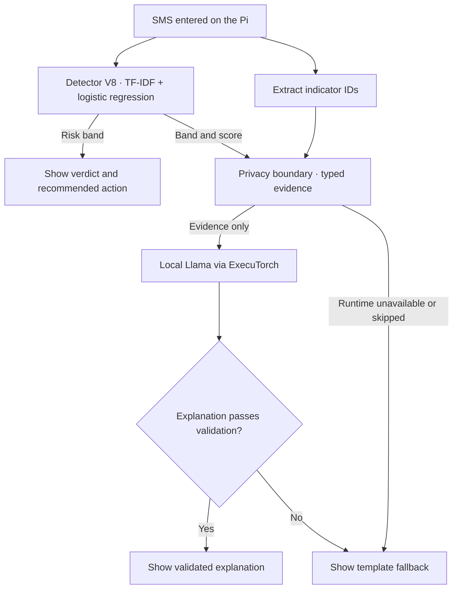

# EdgeShield


EdgeShield helps a user decide what to do with a suspicious text on a Raspberry Pi. A local detector scores the SMS and identifies cues such as urgency or a request for an OTP. The user sees the risk band and recommended action immediately. An optional on-device Llama then explains the cues in plain language.

**Bharat AI-SoC Challenge 2026–27 · PS3 · Open Qualifying · Built with Llama**

[Watch the Raspberry Pi 5 demo (Google Drive, 1 min 59 s)](https://drive.google.com/file/d/13Q4j9QwjhtV7gm1LMB2PJhMGTWMVEbHA/view?usp=sharing) · [Download the final technical report (DOCX)](docs/EdgeShield_Report.docx)

**Judges: [run the V8 SMS demo](#run-the-v8-sms-demo).** V8 loads automatically. V1–V7 are available for historical comparisons and regression testing.

## Judge’s guide to datasets and evidence

| What to inspect | Open on GitHub |
| --- | --- |
| **V8 training data** · 3,431 training SMS (2,770 UCI + 661 synthetic), plus 682 for calibration and 1,331 for validation | [Synthetic English/Hinglish development data](data/synthetic/v8_development.jsonl) · [UCI download and local preparation](data/README.md) · [Recorded split counts](results/host/v8/training_validation.json) |
| **V8 test data** · 264 fresh synthetic SMS. V8 classified 238 of 240 labeled cases correctly. The other 24 were ambiguous. | [Read the holdout messages](data/synthetic/v8_holdout.jsonl) · [Evaluation protocol](docs/V8_EVALUATION_PROTOCOL.md) · [Scored results](results/host/v8/v3_v5_v6_v7_v8_evaluation.json) |
| **Model and implementation** | [Frozen V8 model](models/detector_v8.json) · [Training script](scripts/train_detector_v8.py) · [Assessment code](src/edgeshield/pipeline.py) · [V8 tests](tests/test_detector_v8.py) |
| **Physical Raspberry Pi 5 run** | [Device benchmark](results/pi5/v8-device-20261124/v8_offline_benchmark.json) · [Network trace](results/pi5/v8-device-20261124/v8_offline_network.trace) · [Deployment guide](docs/PI5_DEPLOYMENT.md) |
| **Experimental phishing URL data** · 6,896 training URLs | [Indian development examples](data/synthetic/url_indian_dev.jsonl) · [URL holdout](data/synthetic/url_holdout.jsonl) · [Sources and split counts](results/host/url_v1/dataset_manifest.json) |
| **Technical report and future work** | [Report with architecture diagram](docs/REPORT.md#2-system-architecture-and-safeguards) · [Phase 2 network traffic plan](docs/NETWORK_TRAFFIC_PLAN.md) |

## What you can try

| Capability | Status | Evidence |
| --- | --- | --- |
| SMS scam detection | Default CLI mode. Frozen Detector V8 and local Llama exercised offline on a 16 GB Pi 5. Includes English and Hinglish examples. | [Device run](results/pi5/v8-device-20261124/) · [SMS evaluation](docs/V8_EVALUATION_PROTOCOL.md) |
| Phishing URL detection | Experimental CLI mode. Scores the structure of one URL locally without visiting the site. Includes host results and a documented 8 GB Pi 5 trial. | [Prototype and device notes](docs/PHISHING_URL_DETECTION.md) · [Host results](results/host/url_v1/) |
| Network traffic analysis | Phase 2 design for detecting anomalous traffic. Packet acquisition, classifier deployment and device benchmarks are planned. | [Network traffic plan](docs/NETWORK_TRAFFIC_PLAN.md) |

## Run the V8 SMS demo

From the repository root on Linux with Python 3.10–3.13, install the pinned dependencies once. The built-in demos run locally and use a labeled template explanation until you configure the licensed Llama runtime.

```bash
python3 -m venv .venv
. .venv/bin/activate
python -m pip install -r requirements/host.txt
python -m pip install --no-build-isolation --no-deps -e .
edgeshield --demo
```

The demo runs four English and Hinglish SMS examples. Look for `Detector: loaded (4d3481555460)` in the startup banner to confirm V8. Each example prints a threat band, indicators, recommended action and explanation source. On a host without the Llama runtime, `Template fallback` is expected.

To check V8 specifically, run `python -m pytest -q tests/test_detector_v8.py` in the same environment. The [full verification](#verify-the-submission) also covers earlier detectors and the URL prototype.

**Optional URL demo:** `edgeshield --mode url --demo` runs the separate experimental phishing detector.

For an interactive session, use `edgeshield --repeat` for SMS or `edgeshield --mode url --repeat` for URLs. To run the model-backed demo on a prepared Pi, follow the [Pi 5 deployment guide](docs/PI5_DEPLOYMENT.md) and run `bash deploy/pi5/launch.sh --demo`.

## How the Pi assesses an SMS



The risk verdict appears before Llama runs. For example, if an SMS asks the user to share an OTP, the evidence record can carry the cue `OTP_REQUEST`. The OTP digits and original wording stay outside the model prompt. [Evidence schema](src/edgeshield/evidence.py) · [Assessment code](src/edgeshield/pipeline.py)


## Results and their limits

| Measurement | Recorded result | Where to verify |
| --- | --- | --- |
| V8 SMS detector latency | **1.80 ms median** on the 16 GB Pi 5. Full advisory response took **6.51 s median** and **6.85 s p95** across five requests. | [Benchmark JSON](results/pi5/v8-device-20261124/v8_offline_benchmark.json) |
| Offline advisory | **5/5** explanations passed validation with zero fallbacks. Ethernet and Wi-Fi were down. The trace contained zero IPv4/IPv6 socket matches during the recorded run. | [Device evidence and trace](results/pi5/v8-device-20261124/) |
| V8 synthetic SMS holdout | **238/240 correct**. Of 120 scams, 119 were flagged and one was uncertain. One of 120 legitimate messages was flagged. The evaluation excluded 24 ambiguous examples. | [Evaluation results](results/host/v8/v3_v5_v6_v7_v8_evaluation.json) |
| URL temporal test | **267/477** positive URLs flagged (**55.97% recall**). Another 113 were uncertain and 97 received the legitimate band. The separate curated holdouts use different samples. | [URL evaluation](results/host/url_v1/evaluation_report.json) |

Synthetic evaluation does not establish real-world accuracy. Explanation validation checks whether the wording follows the evidence. Human clarity testing and sustained thermal testing of V8 remain open. V8 peaked at **72.7 °C over 48.18 s**. The earlier V2 run reached **83.7 °C over 605.4 s** and throttled under passive cooling. [Compare the two measured runs](docs/REPORT.md#sustained-v8-operation). [Limitations](docs/LIMITATIONS.md)

## Verify the submission

Use the activated environment above and install GNU time for the thermal-trial integration test (Debian/Ubuntu package `time`). Run from the repository root. The first command checks the frozen V8 detector and seven files from the recorded Pi run.

```bash
sha256sum -c results/pi5/v8-device-20261124/SHA256SUMS
python -m pytest -q
python scripts/package_bundle.py --source-only
```

| Review material | Location |
| --- | --- |
| Technical report and architecture | [Report](docs/REPORT.md) · [Architecture](docs/ARCHITECTURE.md) · [Privacy](docs/SECURITY.md) |
| Training data and evaluation | [Data provenance](docs/SOURCES_DATA.md) · [V8 protocol](docs/V8_EVALUATION_PROTOCOL.md) |
| Hardware setup and model access | [Pi 5 deployment](docs/PI5_DEPLOYMENT.md) · [ExecuTorch setup](docs/EXECUTORCH.md) |
| Project status | [Engineering evidence](PROJECT_STATUS.md) |

Original EdgeShield code is distributed under the [project license](LICENSE). Meta Llama weights and tokenizer require separate access and are excluded from the public bundle. [Third-party runtime sources](docs/SOURCES_RUNTIME.md)
