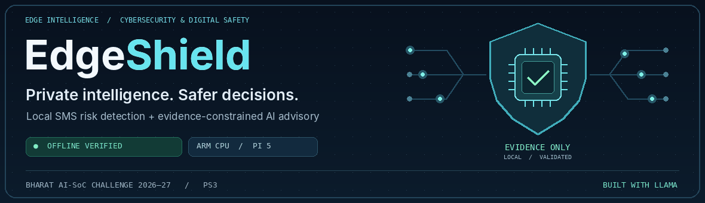
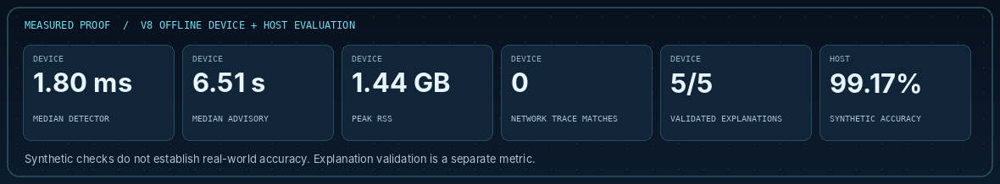
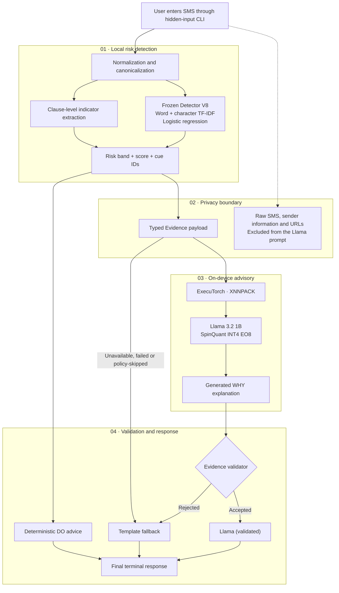
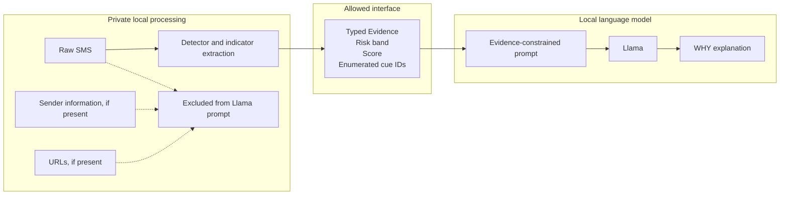
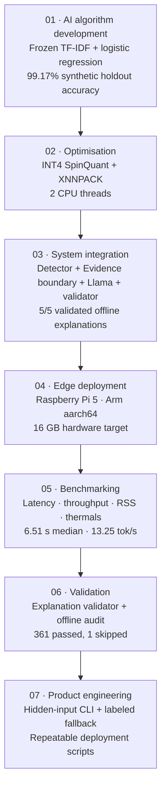
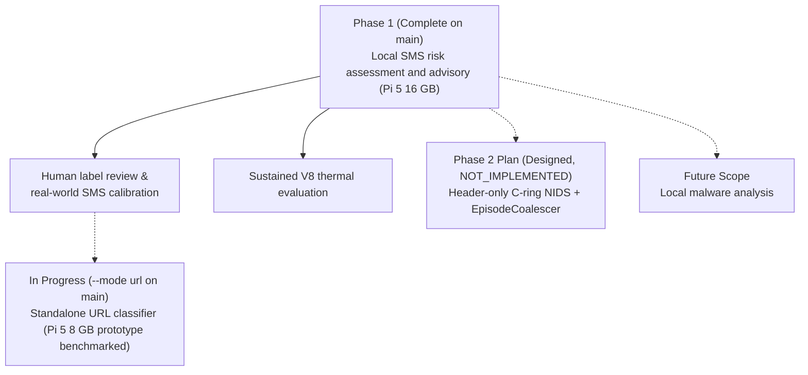

<a name="top"></a>

<div align="center">



<h3>Private intelligence. Safer decisions.</h3>

<p>On-device SMS scam detection and evidence-constrained AI advisory.</p>

<strong>Bharat AI-SoC Challenge 2026–27 (2nd Edition)</strong>

<p>
PS3: On-device threat, phishing &amp; scam detection<br>
Cybersecurity &amp; Digital Safety · Open Qualifying
</p>


<br>



<p>
<sub>Synthetic evaluation does not establish real-world accuracy.</sub>
</p>

<h3>Built with Llama</h3>

<strong>Verified on physical Raspberry Pi 5 · 16 GB · CPU-only</strong>

</div>

---


<div align="center">

[Fast Lane](#judges-fast-lane) ·
[Compliance](#challenge-compliance-matrix) ·
[Architecture](#architecture) ·
[Results](#verified-results) ·
[Engineering Journey](#engineering-journey)

[Privacy](#privacy-and-security) ·
[Quick Start](#quick-start) ·
[Evidence](#reproducibility-and-evidence) ·
[Documentation](#documentation)

</div>

---

## Judge's Fast Lane

> [!IMPORTANT]
> EdgeShield has been verified on a physical Raspberry Pi 5 using
> CPU-only inference, with Ethernet and Wi-Fi disconnected.
> The detector determines risk independently of the language model.

| Headline proof | Measured outcome | Evidence |
| :--- | :--- | :--- |
| Physical edge deployment | Raspberry Pi 5 · 16 GB · Arm aarch64 | [Hardware](#hardware-target) |
| Offline execution | **0** AF_INET/AF_INET6 matches | [Offline proof](#offline-verification) |
| On-device Llama | **5/5** validated · 0 fallbacks | [Inference results](#offline-verification) |
| Full advisory latency | **6.51 s** median · 6.85 s p95 | [Performance](#latency-and-performance) |
| Local risk detection | **1.80 ms** median | [Performance](#latency-and-performance) |
| Detector evaluation | **99.17%** synthetic holdout accuracy | [Evaluation](#detector-evaluation) |
| Memory efficiency | **1.44 GB** peak RSS · 0 B swap | [Resources](#resources-and-thermals) |
| Software verification | **361 passed, 1 skipped** | [Test suite](#software-verification) |
| Evidence integrity | **SHA256SUMS 8/8 OK** | [Evidence archive](results/pi5/v8-device-20261124/) |
| Recorded hardware demo | ❌ MISSING — capture pending | [Submission status](#submission-artifacts) |

> [!NOTE]
> The detector accuracy is measured on a synthetic holdout.
> Explanation validation is a separate metric.
> Neither establishes real-world Indian SMS scam detection accuracy.

**Latest recorded hardware verification:** 24 November 2026.

**Submission deadline:** 25 November 2026 (official Phase 1 deadline).

---

## Challenge Compliance Matrix

EdgeShield addresses PS3 through one complete, testable, on-device
SMS security workflow. The following matrix maps the implemented
capabilities and submission artifacts to the stated challenge
requirements and deliverables.

| Requirement | How EdgeShield meets it | Evidence link | Status |
| :--- | :--- | :--- | :--- |
| Llama-family model for advisory/reasoning | `Llama-3.2-1B-Instruct-SpinQuant_INT4_EO8` generates evidence-constrained explanations | [Model Setup](docs/EXECUTORCH.md) · [Device Evidence](results/pi5/v8-device-20261124/) | ✅ VERIFIED |
| ExecuTorch as on-device runtime | Pinned commit `985c1cec…`, XNNPACK CPU backend, native Pi 5 Cortex-A76 runner | [Runtime Sources](docs/SOURCES_RUNTIME.md) · [Pinned Configuration](#pinned-artifacts-and-identifiers) | ✅ VERIFIED |
| Runs entirely on-device, no cloud dependency | `eth0` and `wlan0` DOWN, empty routes, 0 AF_INET/AF_INET6 matches | [Offline Audit](results/pi5/v8-device-20261124/) | ✅ VERIFIED |
| Scam SMS detection | Frozen Detector V8 independently performs statistical risk assessment | [Evaluation Protocol](docs/V8_EVALUATION_PROTOCOL.md) · [V8 Results](results/host/v8/) | ✅ VERIFIED |
| Plain-language explanation for non-experts | Llama generates a concise `WHY:` explanation, checked by the validator | [Output Interpretation](#how-to-read-the-output) · [Device Evidence](results/pi5/v8-device-20261124/) | ✅ VERIFIED |
| Remediation recommendations | Application-controlled, deterministic `DO:` recommendations | [Architecture](docs/ARCHITECTURE.md) · [Output Interpretation](#how-to-read-the-output) | ✅ VERIFIED |
| Local data processing / privacy boundary | Only typed Evidence enters the Llama prompt; raw SMS, sender information and URLs are excluded | [Security & Privacy](docs/SECURITY.md) · [Architecture](#architecture) | ✅ VERIFIED |
| Source code (GitHub) | Project source, frozen detector, deployment scripts and tests | [Repository Source](./) · [Project Status](PROJECT_STATUS.md) | ⚠️ PENDING — confirm final submission repository URL |
| Application | Terminal-first CLI with hidden input, Llama advisory and labeled fallback | [Pi 5 Deployment](deploy/pi5/README.md) · [Quick Start](#quick-start) | ✅ VERIFIED |
| Technical report | Technical report documented at `docs/REPORT.md` | [Technical Report](docs/REPORT.md) | ⚠️ PENDING — confirm final submission version |
| Demonstration video | Disconnected Pi 5 recording showing network state and genuine validated Llama output | [Video Script](submission/VIDEO_SCRIPT.md) · [Demo Status](#demo-video-status) | ❌ MISSING · ⚠️ [TODO] pending capture |

> [!NOTE]
> This matrix maps project capabilities to the stated challenge
> requirements. It is not an official scoring rubric, organiser
> assessment, or certification of submission compliance.

### Deliverables Checklist

| Phase 1 deliverable | Artifact | Status |
| :--- | :--- | :--- |
| Source code | [Repository Source](./) · [Project Status](PROJECT_STATUS.md) | ⚠️ PENDING — [TODO: Confirm final GitHub submission URL] |
| Application | [CLI and Deployment Instructions](#quick-start) | ✅ VERIFIED |
| Demonstration video | [Video Script](submission/VIDEO_SCRIPT.md) · [Demo Status](#demo-video-status) | ❌ MISSING — ⚠️ [TODO] pending capture |
| Technical report | [Technical Report](docs/REPORT.md) | ⚠️ PENDING — [TODO: Confirm final report submission version] |

**Phase 1 scope:** One complete SMS scam detection and advisory workflow.

**Submission deadline:** 25 November 2026 (official Phase 1 deadline).

---

## The Problem and Our Approach

Fraudulent SMS messages exploit urgency, banking impersonation,
account-verification requests, suspicious links, and social engineering
to influence financial decisions.

A useful scam assistant must address more than classification accuracy.
It must also protect the private information contained in the messages
it analyses.

EdgeShield explores a local-first alternative: statistical detection
for risk assessment, followed by constrained on-device language
generation for user-facing explanations.

| Engineering concern | EdgeShield's approach |
| :--- | :--- |
| Sensitive SMS content | Process locally without cloud inference |
| English and Hinglish scam patterns | Word and character features, canonicalization, and synthetic banking examples |
| Unreliable language-model decisions | Independent statistical detector |
| Unsupported AI explanations | Evidence-constrained generation and validation |
| Limited edge-compute resources | Quantized Llama through ExecuTorch on Arm CPU |
| Runtime failures | Explicitly labeled deterministic fallback |
| Unsafe recommendations | Application-controlled action guidance |

The language model explains the decision. It does not own the decision.

### Why On-Device?

- **Real-time responsiveness:** Local risk detection takes **1.80 ms**
  median, independently of Llama generation. The complete advisory
  takes 6.51 s median in the recorded offline benchmark. These are
  measured response times, not hard real-time deadline guarantees.

- **Privacy-aware processing:** The offline network trace recorded
  **0 AF_INET/AF_INET6 matches**. Combined with the typed Evidence
  boundary, the application keeps raw SMS content outside the Llama
  prompt and avoids cloud inference during the verified run.

- **Offline capability:** With Ethernet and Wi-Fi down and no routes,
  **5/5** requests produced validator-accepted Llama explanations
  with 0 fallbacks, demonstrating that the configured advisory
  pipeline operates without network connectivity.

[Offline Verification](#offline-verification) ·
[Privacy and Security](#privacy-and-security)

### Design principles

- Detection must remain functional without Llama.
- Raw SMS content must remain outside the Llama prompt.
- Generated explanations must pass validation before display.
- Recommended actions must remain deterministic.
- Hardware and performance claims must be traceable to recorded evidence.

---

## Architecture

EdgeShield separates statistical detection, privacy enforcement,
language generation, and output validation into four distinct stages.



> [!IMPORTANT]
> Only a typed Evidence payload crosses into the Llama prompt:
> risk band, statistical score, and enumerated cue IDs.
>
> **Raw SMS text, sender information, and URLs never enter Llama.**

> [!NOTE]
> **Hardware note:** The entire pipeline runs on the Raspberry Pi 5
> Arm CPU using the XNNPACK CPU backend. No Hailo accelerator,
> dedicated NPU, or other external AI accelerator is used in the
> verified configuration.

<details>
<summary><strong>Stage 01 — Statistical detector internals</strong></summary>

<br>

The frozen Detector V8 combines:

- Word-level TF-IDF features.
- Character-level TF-IDF features.
- Logistic regression.
- Numeric and banking-specific canonicalization.
- Clause-level extraction of enumerated indicators.

The detector combines historical UCI spam data with synthetic
Indian and Hinglish banking examples.

Canonicalization covers amounts, dates, OTP and short-number
separation, and account masks.

| Configuration | Value |
| :--- | :--- |
| Default detector | `models/detector_v8.json` |
| Thresholds | `[0.55, 0.675]` |
| Indicator implementation | `src/edgeshield/indicators.py` |
| Indicator authority | Observable cues; no statistical score override |

Indicators such as `BANK_IMPERSONATION` and `KYC_IMPERSONATION`
represent observable lexical patterns, not authenticated sender identity
or proof of impersonation.

`LINK_PRESENT` identifies a link-related cue. It is not independent
phishing URL classification.

Earlier detector versions remain available for inspection.

</details>

<details>
<summary><strong>Stage 02 — Privacy boundary and data flow</strong></summary>

<br>



The typed `Evidence` interface restricts the information supplied
to the language model.

This is a logical application-level data boundary. It is distinct
from the network-disconnection verification performed on the Pi 5.

Raw input is processed locally for detection but excluded from
the Llama prompt.

</details>

<details>
<summary><strong>Stage 03 — Arm edge inference stack</strong></summary>

<br>

| Component | Implementation |
| :--- | :--- |
| Model | `Llama-3.2-1B-Instruct-SpinQuant_INT4_EO8` |
| Runtime | ExecuTorch |
| CPU backend | XNNPACK |
| Runner profile | `pi5-cortex-a76-native` |
| Architecture | `aarch64` |
| CPU threads | `2` |
| Hardware accelerator | CPU-only execution; no Hailo/NPU |
| Model responsibility | Generate the `WHY:` explanation |

The model is deployed locally through ExecuTorch using a dedicated
Raspberry Pi 5 runner.

The frozen detector is independent of model availability.

See [ExecuTorch & Model Setup](docs/EXECUTORCH.md) and
[Runtime Sources](docs/SOURCES_RUNTIME.md).

</details>

<details>
<summary><strong>Stage 04 — Explanation validation and fallback</strong></summary>

<br>

`src/edgeshield/validator.py` checks generated explanations against
allowed evidence-supported statements.

The application distinguishes between two explanation sources:

- `Llama (validated)` — the generated explanation passed validation.
- `Template fallback` — the displayed explanation did not come
  from Llama.

Fallback occurs when generation is unavailable, rejected, failed,
or skipped by policy.

Every `DO:` recommendation is owned by application code rather than
generated freely by the language model.

</details>

[Back to top](#top)

---

## Engineering Journey

### From AI algorithm development to product engineering

The Bharat AI-SoC Challenge's theme, **"Applied AI on SoC"**, represents
a shift from building AI applications to engineering AI-enabled
products on SoCs.

EdgeShield maps its development to the challenge's stated engineering
journey: algorithm development, optimisation, system integration,
edge deployment, benchmarking, validation, and product engineering.



| Engineering stage | Implemented work and supporting evidence |
| :--- | :--- |
| AI algorithm development | Frozen Detector V8 achieves 99.17% synthetic holdout accuracy. [Evaluation](docs/V8_EVALUATION_PROTOCOL.md) |
| Optimisation | INT4 SpinQuant model, XNNPACK CPU backend and 2 CPU threads. [Runtime Setup](docs/EXECUTORCH.md) |
| System integration | Independent detector, typed privacy boundary, local Llama and validator; 5/5 accepted offline explanations. [Architecture](docs/ARCHITECTURE.md) |
| Edge deployment | Native `pi5-cortex-a76-native` runner on a physical Raspberry Pi 5, Arm aarch64, 16 GB RAM. [Deployment](docs/PI5_DEPLOYMENT.md) |
| Benchmarking | 6.51 s median latency, 13.25 tok/s median decode throughput, 1.44 GB peak RSS, 72.7 °C maximum sampled temperature. [Device Evidence](results/pi5/v8-device-20261124/) |
| Validation | 361 passed, 1 skipped; 0 AF_INET/AF_INET6 matches in the offline network trace. [Software Verification](#software-verification) · [Offline Audit](#offline-verification) |
| Product engineering | Terminal-first UX, hidden SMS input, labeled fallback, deterministic advice and deployment scripts. [Application](#quick-start) · [Deployment README](deploy/pi5/README.md) |

> [!NOTE]
> The engineering journey represents the implemented project workflow.
> Its stages may be iterative rather than strictly chronological.
>
> The 99.17% result is a synthetic detector-evaluation metric.
> The 5/5 result measures explanation-validator acceptance.
> These are separate measurements.

[Back to top](#top)

---

## Verified Results

All current V8 hardware results below refer to the physical
Raspberry Pi 5 verification recorded on 24 November 2026.

This is the hardware verification date, not the Phase 1 submission
deadline.

Historical V2 benchmarks are explicitly separated from current V8
results.

### Status convention

| Status | Meaning |
| :--- | :--- |
| ✅ VERIFIED | Supported by recorded project evidence |
| ⚠️ PENDING | Additional work, confirmation or validation remains |
| ❌ MISSING | Required artifact or evidence is not yet available |

### Hardware Target

| Hardware / software | Verified configuration |
| :--- | :--- |
| Device | Raspberry Pi 5 Model B Rev 1.1 |
| Memory | 16 GB RAM |
| Architecture | Arm `aarch64` |
| Operating system | Debian GNU/Linux 13 (Trixie) |
| Python | 3.13.5 |
| GNU C Library | `glibc 2.41` |
| Inference backend | XNNPACK CPU |
| Runner | `pi5-cortex-a76-native` |
| CPU threads | `cpu_threads=2` |
| AI acceleration | CPU-only; no Hailo/NPU accelerator |
| Physical deployment | ✅ VERIFIED |

[Pi 5 Deployment Guide](docs/PI5_DEPLOYMENT.md) ·
[Pi 5 Status](results/pi5/STATUS.json)

### Offline Verification

**Detector V8 + ExecuTorch Llama — ✅ VERIFIED**

The disconnected verification demonstrates local detection and genuine
on-device Llama advisory execution under the recorded network conditions.

| Verification check | Recorded result |
| :--- | :--- |
| Ethernet interface | `eth0 DOWN` |
| Wi-Fi interface | `wlan0 DOWN` |
| Remaining interface | `lo` only |
| Routing table | `[]` |
| AF_INET/AF_INET6 matches | **0** |
| Validator-accepted Llama responses | **5/5** |
| Fallbacks | **0** |
| Single SCAM CLI check | `Llama (validated)` |
| Single CLI response time | 7.76 s |
| Offline benchmark duration | 48.18 s |
| Evidence integrity | `SHA256SUMS` 8/8 OK |
| Recorded UTC timestamp | `2026-11-24T05:27:28Z` |

> [!IMPORTANT]
> The network trace contained zero AF_INET/AF_INET6 matches.
> Both physical network interfaces were down, and the routing table
> was empty during the recorded verification.

<details>
<summary><strong>Inspect the offline verification artifacts</strong></summary>

<br>

Evidence directory:

[`results/pi5/v8-device-20261124/`](results/pi5/v8-device-20261124/)

Recorded evidence includes:

- `offline_routes.json` containing `[]`.
- `v8_offline_network.trace` with 0 AF_INET/AF_INET6 matches.
- `SHA256SUMS` audit: 8/8 OK.
- `runtime_config_sha256: a4f1f80b...`.

The runtime configuration hash is shown as the abbreviated value
recorded in the source README.

The 5/5 outcome measures explanation-validator acceptance.
It is not a detector-accuracy measurement.

</details>

### Latency and Performance

**Current V8 offline hardware benchmark — ✅ VERIFIED**

| Performance metric | Measured result |
| :--- | ---: |
| Median full-response latency | **6.51 s** |
| p95 full-response latency | **6.85 s** |
| Median detector latency | **1.80 ms** |
| Median model-load latency | 1.21 s |
| Median time to first token (TTFT) | 3.17 s |
| Median decode throughput | 13.25 tok/s |

The detector produces its local risk score independently of
language-model generation.

Full-response latency and detector latency measure different stages
of the pipeline and should not be treated as interchangeable.

[Current V8 hardware evidence](results/pi5/v8-device-20261124/)

### Resources and Thermals

**Current V8 offline hardware benchmark — ✅ VERIFIED**

| Resource metric | Measured result |
| :--- | ---: |
| Peak RSS | **1.44 GB** |
| Peak RSS, binary units | 1.34 GiB |
| Swap usage | **0 B** |
| Maximum sampled temperature | 72.7 °C |
| Throttling status | `throttled=0x0` |

The recorded short offline benchmark completed without observed
throttling or swap usage.

> [!NOTE]
> These measurements describe the recorded offline V8 benchmark.
> They do not establish sustained thermal performance for V8.
> The historical sustained benchmark is reported separately below.

### Software Verification

**Detector V8 offline test suite and detector batch — ✅ VERIFIED**

| Software verification | Result |
| :--- | :--- |
| Tests passed | **361** |
| Tests skipped | 1 |
| Test-suite duration | 52.35 s |
| Repeated batch detections | 50 |
| Batch structure | 5 runs of 10 synthetic messages |
| SCAM outputs | 25 |
| LEGITIMATE outputs | 20 |
| UNCERTAIN outputs | 5 |
| Average detector latency | 2.4321 ms |
| Minimum detector latency | 2.2172 ms |
| Maximum detector latency | 5.0981 ms |
| Temperature | 63.7 °C |
| Throttling | `throttled=0x0` |

<details>
<summary><strong>Test scope and skipped-test explanation</strong></summary>

<br>

- One corpus-excluded test was skipped at `tests/test_detector.py:71`.
- The offline detector batch used `Template fallback`.
- The batch validates detector execution independently of Llama.
- The batch output distribution is not a real-world accuracy metric.

Evidence:
[Pi 5 V8 Offline Detector Archive](results/pi5/v8-offline-20261124/).

</details>

---

### Detector Evaluation

**Detector V8 — ✅ VERIFIED, host-side evaluation**

> [!WARNING]
> Synthetic checks do not establish real-world accuracy.
> Human label review and real-world calibration remain pending.
> The detector score is not a calibrated real-world Indian scam
> probability.

#### V8 synthetic holdout

Dataset: `v8_holdout`

Recorded evaluation: 240 labeled synthetic messages;
24 ambiguous messages excluded.

| Evaluation metric | Measured result |
| :--- | ---: |
| Accuracy | **99.17%** |
| Recall | 99.17% |
| False-positive rate (FPR) | 0.83% |
| Abstentions | 0.42% |
| ROC-AUC | **0.99993** |
| Brier score | 0.00857 |

<details>
<summary><strong>Recorded confusion matrix</strong></summary>

<br>

```text
[[119, 0, 1],
 [0, 1, 119]]
```

The matrix is reproduced exactly as recorded.

Refer to the evaluation protocol for class ordering, abstention
handling, dataset partitioning, and metric definitions.

[V8 Evaluation Protocol](docs/V8_EVALUATION_PROTOCOL.md)

</details>

#### Cross-dataset evaluation

| Dataset | Recorded size | V8 accuracy |
| :--- | ---: | ---: |
| `v8_holdout` | 240 | 99.17% |
| `v3_holdout` | 160 | 99.38% |
| `v2_holdout` | 120 | 96.67% |
| `uci_test` | 1,148 | 98.17% |

Additional UCI test results:

| Metric | Result |
| :--- | ---: |
| False-positive rate | 0.00% |
| Recall | 88.41% |

The UCI test result is based on historical spam data and should not
be interpreted as validation against contemporary Indian banking
scam messages.

[Full V8 Evaluation Results](results/host/v8/v3_v5_v6_v7_v8_evaluation.json) ·
[Evaluation Archive](results/host/v8/) ·
[Data Sources](docs/SOURCES_DATA.md)

<details>
<summary><strong>Detector evolution and reproducibility</strong></summary>

<br>

The default detector is frozen as:

`models/detector_v8.json`

Its thresholds are:

```text
[0.55, 0.675]
```

Detector V2 remains available through:

```bash
--detector models/detector_v2.json
```

V2 thresholds:

```text
[0.25, 0.275]
```

Earlier versions from `models/detector_v2.json` through `v7`,
and the preserved failed V1 baseline at `models/detector.json`,
remain inspectable through `--detector`.

Retaining earlier versions allows the development history and
unsuccessful approaches to remain visible rather than presenting
only the final model.

[V3 Evaluation Report](docs/V3_EVALUATION_REPORT.md) ·
[V2 Results](docs/V2_RESULTS.md)

</details>

---

### Archived Sustained Benchmark

**Historical Detector V2 `f37c3dd9...` — ✅ VERIFIED**

These results are from the archived B0 hardware configuration.
They are not current V8 sustained-performance results.

The benchmark used a passive heatsink and an open board.

| Sustained benchmark metric | Recorded result |
| :--- | ---: |
| Duration | **605.4 s** |
| Back-to-back requests | 91 |
| Validator-accepted advisories | **91/91** |
| Fallbacks | 0 |
| Median full-response latency | 6.70 s |
| p95 full-response latency | 6.81 s |
| Median model-load latency | 1.22 s |
| Median runtime TTFT | 3.20 s |
| Median decode throughput | 13.49 tokens/s |
| Peak runner RSS | 1.44 GB |
| Peak runner RSS, binary units | 1.34 GiB |
| Peak runner RSS, bytes | 1,443,217,408 |
| Swap usage | 0 bytes |
| Peak sampled temperature | **83.7 °C** |
| Final throttle flag | `throttled_after=0xe0008` |

> [!WARNING]
> Thermal throttling was observed under sustained passive load.
> This historical result identifies a thermal constraint for
> prolonged deployment. It is not evidence of throttle-free
> sustained operation.

The 91/91 outcome measures explanation-validator acceptance,
not detector accuracy.

[Archived B0 Benchmark](results/pi5/archive/20261118-B0-full/benchmark.json)

<details>
<summary><strong>Historical detector-only benchmark and smoke tests</strong></summary>

<br>

#### V2 detector-only performance

| Metric | Result |
| :--- | ---: |
| Samples | 100 |
| Median latency | 0.89 ms |
| p95 latency | 0.92 ms |

[Detector-only Benchmark](results/pi5/archive/20261118-B0-full/benchmark-detector.json)

#### V2 Llama smoke tests

- 4/4 built-in English and Hinglish synthetic demo cases returned
  `Source: Llama (validated) | Status: ACCEPTED`.
- 2/2 fallback cases returned explicitly labeled `Template fallback`.

Evidence:

- [Smoke Test](results/pi5/archive/20261118-B0-full/smoke_test.txt)
- `fallback_smoke.jsonl`
- [Full B0 Archive](results/pi5/archive/20261118-B0-full/)

</details>

<details>
<summary><strong>Historical disconnected offline verification — 19 November 2026</strong></summary>

<br>

Detector V2 `f37c3dd9...` — ✅ VERIFIED

| Verification metric | Result |
| :--- | :--- |
| Ethernet and Wi-Fi | `eth0` and `wlan0` DOWN |
| Remaining interface | `lo` only |
| Routing table | `[]` |
| AF_INET/AF_INET6 calls | Zero |
| Validator-accepted explanations | 5/5 |
| Fallbacks | 0 |
| p95 latency | 6.80 s |
| Peak RSS | 1.44 GB / 1.34 GiB |
| Swap usage | 0 B |
| Maximum temperature | 73.25 °C |
| Throttling | `throttled=0x0` |
| Integrity audit | SHA256SUMS 6/6 OK |
| UTC recording time | `2026-11-19T12:15:54Z` |

Additional evidence:

- `network.trace`
- `inference.json` SHA-256 `a4f1f80b...`, recorded as matching B0.

[Archived Offline Verification](results/pi5/offline-20261119/)

</details>

[Back to top](#top)

---

## Privacy and Security

EdgeShield is designed around data minimization and bounded
language-model responsibility.

| Security property | Implementation |
| :--- | :--- |
| No inbox access | Users manually provide SMS content |
| Hidden interactive input | SMS text is not echoed to the terminal |
| Local detection | Statistical scoring executes on the device |
| No cloud inference | Local ExecuTorch runtime |
| Prompt data minimization | Only typed Evidence enters Llama |
| Explanation validation | Generated output must satisfy validator rules |
| Deterministic recommendations | Application-controlled `DO:` advice |
| Explicit fallback | Clearly labeled `Template fallback` |
| No autonomous messaging actions | No automatic clicking, sending, or deletion |
| No message history | Message-history functionality is not implemented |

> [!IMPORTANT]
> Llama does not determine the statistical risk score and does not
> receive the original SMS.
>
> Its responsibility is limited to generating an explanation from
> the allowed Evidence payload.

Hidden input helps prevent SMS text from appearing in terminal
output. It is not a general guarantee against operating-system-level
logging or memory inspection.

Do not pass private SMS content through command-line arguments
or shell history.

[Security & Privacy](docs/SECURITY.md) ·
[Architecture](docs/ARCHITECTURE.md)

---

## Quick Start

EdgeShield supports two execution paths.

| Environment | Purpose |
| :--- | :--- |
| Raspberry Pi 5 | Primary physical edge deployment with genuine Llama |
| Linux host | Detector development, CLI execution, and tests |

### Raspberry Pi 5

**Primary verified hardware target**

<details>
<summary><strong>Expand Raspberry Pi 5 setup and execution commands</strong></summary>

<br>

Full instructions:

- [Pi 5 Deployment Guide](docs/PI5_DEPLOYMENT.md)
- [Deployment README](deploy/pi5/README.md)
- [ExecuTorch & Model Setup](docs/EXECUTORCH.md)

#### 1. Provision an isolated Python environment

Supported provisioning range: Python 3.10–3.13.

```bash
bash deploy/pi5/setup.sh
```

#### 2. Stage lawfully obtained Llama assets

Follow the model acquisition and export instructions in
[docs/EXECUTORCH.md](docs/EXECUTORCH.md).

After staging the assets under `models/llama/`, create the manifest:

```bash
.venv/bin/python deploy/pi5/create_manifest.py --profile pi5
```

#### 3. Run the genuine Llama smoke test

```bash
bash deploy/pi5/smoke_test.sh
```

#### 4. Launch the interactive hidden-input CLI

```bash
bash deploy/pi5/launch.sh --repeat
```

#### 5. Perform disconnected offline verification

Use a local console, disconnect Ethernet, and turn off Wi-Fi
before running:

```bash
bash deploy/pi5/offline_verify.sh
```

> [!WARNING]
> Do not disconnect the network from a remote SSH session if doing
> so would prevent access to the device.
> Use the local console for disconnected verification.

</details>

### Linux Host

**Detector and CLI execution without gated Llama weights**

<details>
<summary><strong>Expand Linux setup, testing, and CLI commands</strong></summary>

<br>

Public source bundles exclude the gated Meta Llama weights and
compiled `aarch64` runtime binaries.

Without a configured Llama runtime, EdgeShield uses the frozen
V8 detector and explicitly labeled `Template fallback` explanations.

#### 1. Create the Python environment

```bash
python3 -m venv .venv
.venv/bin/python -m pip install -r requirements/host.txt
.venv/bin/python -m pip install --no-deps .
```

#### 2. Execute the test suite

```bash
.venv/bin/python -m pytest -q
```

#### 3. Run a synthetic single-message JSON check

```bash
printf '%s\n' 'Cedar Bank test: Your OTP is 000000. Do not share it with anyone.' | \
  .venv/bin/python -m edgeshield.cli --stdin --json
```

#### 4. Run interactive hidden-input mode

```bash
.venv/bin/python -m edgeshield.cli --repeat
```

Empty input exits the interactive mode.

#### Development workspace commands

To isolate the shell `PYTHONPATH`, use:

```bash
bash scripts/host_python.sh -m pytest -q
```

When host runtime assets are staged:

```bash
bash scripts/run_demo_ubuntu.sh --llama
```

The default detector is verified against:

`models/detector_v8.json.sha256`

</details>

### Obtaining Meta Llama and ExecuTorch Assets

<details>
<summary><strong>Expand lawful model acquisition and runtime preparation</strong></summary>

<br>

Meta Llama 3.2 weights and tokenizer are gated under the
Meta Llama 3.2 Community License.

They are not distributed in the public source repository.

#### Model repository

```text
meta-llama/Llama-3.2-1B-Instruct-SpinQuant_INT4_EO8
```

Pinned revision:

```text
b8c08c95d0476ccb6fc86e9410818d602ecca19d
```

Reviewers must:

1. Request and obtain lawful model access through Hugging Face.
2. Retain Meta's `LICENSE` and `USE_POLICY` / `NOTICE` files.
3. Export `llama3_2.pte`.
4. Cross-build the `aarch64` ExecuTorch runner.
5. Stage the required runtime assets.
6. Generate the deployment manifest.

Pinned ExecuTorch commit:

```text
985c1ceccc8bb8b6a32294f71aeb5d2f299562f7
```

Use [docs/EXECUTORCH.md](docs/EXECUTORCH.md) and
`scripts/export_llama.sh` for the export procedure.

Expected staging layout:

```text
models/llama/
├── llama3_2.pte
├── tokenizer.model
├── LICENSE_AND_NOTICE.md
└── pi5-aarch64/
    ├── llama_main
    └── libllama_runner.so
```

After staging:

```bash
.venv/bin/python deploy/pi5/create_manifest.py --profile pi5
```

</details>

[Back to top](#top)

---

## How to Read the Output

EdgeShield communicates statistical risk, an explanation source,
and application-controlled guidance.

### Risk bands

| Decision band | Interpretation |
| :--- | :--- |
| 🔴 `SCAM` | Elevated estimated scam or spam-derived risk |
| 🟠 `UNCERTAIN` | Intermediate risk requiring caution |
| 🟢 `LEGITIMATE` | Lower estimated risk; not authenticated legitimacy |

The three bands are derived from a binary spam-derived score.
They are not three independently trained ground-truth classes.

V8 default thresholds: `[0.55, 0.675]`.

> [!WARNING]
> A LEGITIMATE result does not authenticate the sender
> or establish that a message is safe.

### Explanation sources

| Source | Meaning |
| :--- | :--- |
| `Llama (validated)` | Configured ExecuTorch runner produced a validator-accepted explanation |
| `Template fallback` | Llama did not supply the displayed explanation |

Fallback may be caused by an unavailable runtime, a rejected
explanation, execution failure, or an advisory-policy decision.

### Illustrative output

The following is a schematic example of the output concepts,
not a captured benchmark transcript or an exact CLI-format guarantee.

```text
Risk band : SCAM
Score     : [detector score]

Source    : Llama (validated)

WHY:
[Validator-accepted, evidence-supported explanation]

DO:
[Deterministic application-controlled recommendation]
```

The `WHY:` explanation communicates evidence-supported risk indicators
in language intended for non-experts.

The `DO:` guidance provides deterministic remediation recommendations
without delegating action selection to the language model.

The detector's score and risk band remain independent of the
language model.

<details>
<summary><strong>Advisory execution policies</strong></summary>

<br>

The `--advisory-policy` option controls when Llama runs.

Available policies:

- `always`
- `elevated`
- `uncertain`
- `off`

Default: `always`.

The `elevated` policy runs Llama only for `SCAM`, `UNCERTAIN`,
or indicator matches.

An explanation skipped by policy is represented by the explicitly
labeled fallback when a fallback explanation is displayed.

</details>

---

## Challenge Alignment

### Bharat AI-SoC Challenge 2026–27 (2nd Edition)

PS3: **"On-device threat, phishing & scam detection"**
(Theme: Cybersecurity & Digital Safety).

Led by Arm with IIT Delhi as mentor institute, MeitY C2S as the
Indian Government partner, supported by the UK Government
(UK-India TSI), with support from Meta.

Theme: **"Applied AI on SoC"**, a shift from building AI applications
to engineering AI-enabled products on SoCs.

| Challenge context | Project alignment |
| :--- | :--- |
| Edition | Bharat AI-SoC Challenge 2026–27 (2nd Edition) |
| Problem statement | PS3: On-device threat, phishing & scam detection |
| Problem-statement theme | Cybersecurity & Digital Safety |
| Challenge theme | Applied AI on SoC |
| Phase | Phase 1 — Open Qualifying |
| Phase 1 deadline | 25 November 2026 (official Phase 1 deadline) |
| Selected application | On-device scam SMS detection and advisory |
| Hardware target | Raspberry Pi 5 |
| Inference runtime | ExecuTorch |
| Advisory model | Llama 3.2 1B Instruct SpinQuant INT4 EO8 |

### Phase 1 scope

PS3 lists network intrusion detection, phishing URL detection,
and scam SMS detection as example application areas.

EdgeShield Phase 1 focuses on a complete, testable,
on-device SMS security workflow.

This scope follows the official challenge brief and PS3
mentoring slides 03 and 11, which recommend a complete
on-device security workflow and identify scam SMS as a
valid primary scenario.

| Security application | Phase / Mode | Implementation status |
| :--- | :--- | :--- |
| Pasted SMS scam detection | Phase 1 (`--mode sms`, default on `main`) | ✅ VERIFIED |
| Evidence-constrained SMS advisory | Phase 1 (`--mode sms`, default on `main`) | ✅ VERIFIED |
| Standalone phishing URL detection | In Progress (`--mode url` prototype on `main`) | 🚧 IN PROGRESS — code & host metrics on `main`; Pi 5 (8 GB) prototype benchmarked |
| Network traffic anomaly & intrusion detection | Phase 2 blueprint | 📐 DESIGNED — `NOT_IMPLEMENTED` ([Plan](docs/NETWORK_TRAFFIC_PLAN.md)) |
| Malware analysis | Future scope | ⚠️ DEFERRED |

On `main`, the Phase 1 verified default (`--mode sms` with frozen `models/detector_v8.json`) analyzes pasted SMS messages. A `LINK_PRESENT` cue within an SMS is not independent URL classification. For judge reference, `main` also includes the **in-progress** standalone Phishing URL prototype (`--mode url`, `models/url_detector_v1.json`, [docs/PHISHING_URL_DETECTION.md](docs/PHISHING_URL_DETECTION.md), host artifacts in [results/host/url_v1/](results/host/url_v1/)).

### Multi-Surface PS3 Progress (Phishing URLs & Phase 2 Network Plan)

Alongside our completed **16 GB Raspberry Pi 5** offline SMS submission (`--mode sms`), we included our **in-progress** standalone Phishing URL prototype (`UrlDetectorV1`, `--mode url`, [docs/PHISHING_URL_DETECTION.md](docs/PHISHING_URL_DETECTION.md)) on `main` with measurements recorded on a **physical Raspberry Pi 5 Model B Rev 1.1 (8 GB, AArch64, Debian 13 Trixie, `6.18.50+rpt-rpi-2712`, `glibc 2.41`, Python `3.13.5`)** and host benchmarks in [results/host/url_v1/](results/host/url_v1/), and finalized our **Phase 2 Network Traffic Plan (`NOT_IMPLEMENTED`)**:

#### Phishing URL Prototype — Measured Pi 5 (8 GB) Benchmarks (`In Progress`, USB Archive `edgeshield_url_transfer/`)

| Benchmark Stage | Dataset / Scope | Key Measured Results (Pi 5 8 GB) |
| :--- | :--- | :--- |
| **Unit Tests** | `82` URL detector tests | **`82/82` passed**, `0` failed (`1.35 s`) |
| **Stress Suite** | `139` URLs (`79` benign / `60` phish + fuzz) | **`0/79` benign `SCAM` FP** (`77` `LEGITIMATE`, `2` `UNCERTAIN`: `zoom.us`, `localhost:8000`); **`60/60` (`100%`)** phish `SCAM`; `14/14` malformed rejected; `11/11` bypass checks passed; `0` sentinel leaks; `0` network calls; **`1.1098 ms`** med (`1.3329 ms` p95) |
| **Temporal Evaluation** | `1,881` (`1,404` neg / `477` pos) | `83.47%` acc · `93.36%` prec · **`55.97%` `SCAM` recall** · `1.35%` FPR · `69.99%` F1 · `10.37%` abstention · `0.93168` ROC-AUC · `0.07891` Brier · confusion `[[1303, 82, 19], [97, 113, 267]]` · `1.0983 ms` med |
| **General Holdout** | `200` (`100` neg / `100` pos, separate set) | `99.50%` acc · `100%` prec · `100%` recall · `0%` FPR · `0.50%` abstention · `1.000` ROC-AUC · `0.00286` Brier · `1.1019 ms` med |
| **Indian Holdout** | `75` (`25` neg / `50` pos, separate set) | `100%` acc · `100%` prec · `100%` recall · `0%` FPR · `1.000` ROC-AUC · `0.00068` Brier · `1.1501 ms` med |
| **Llama Runtime & Resources** | `4/4` URL demo + standalone KYC spoof (`0.9999996` `SCAM`) | **`4/4` Llama `Validated / ACCEPTED`** (~`2.20 ms` avg detector, ~`6.286 s` avg Llama; standalone `6,652.06 ms` Llama); Max RSS **`1,409,328 KB`** (~`1.34 GiB`), `0` swap, `0` socket msgs, `52–66 °C`, **`throttled=0x0`** |
| **Controlled Network Checks** | `tcpdump 4.99.5` + `strace -f -e trace=network` (`wlan0`) | With Chromium terminated: **`0` packets captured** (`0` dropped) over `45 s` during full `4/4` Llama demo (`edgeshield_no_chromium.pcap`); `5` pkts in control ping (`capture_control.pcap`); **`0` matches** for `socket()`/`connect()`/`sendto()`/`recvfrom()` in `edgeshield_process_network.trace`; USB SHA-256 **`12/12 OK`** (URL) & **`8/8 OK`** (network-traffic) |

> [!NOTE]
> **Strict Scoped Interpretation (URL Prototype):** Temporal recall is **`55.97%`** (`97/477` missed as `LEGITIMATE`, `113/477` `UNCERTAIN`)—this must **not** be reported as 100% phishing detection. General (`200`) and Indian (`75`) holdouts are separate benchmark slices and do not establish universal real-world detection. Validation status `ACCEPTED` covers explanation formatting only (never URL safety), and the `45 s` zero-packet capture / `strace` check apply solely to those observed runs rather than proving global network impossibility.

#### Phase 2 Network Traffic Anomaly & Intrusion Plan (`NOT_IMPLEMENTED`)

- **Dataset Integrity & Anti-Shortcut Protocol:** Restricts `NSL-KDD` strictly to a historical sanity baseline; combines DistriNet-corrected `CICIDS2017` and `NF-UNSW-NB15-v2` into a **28-feature encryption-agnostic L3/L4 header-only flow schema** (dropping all IPs, flow IDs, timestamps, raw source ports, and `sttl`/`dttl`/`ct_state_ttl`), calibrated on consented `snaplen=96` Indian lab VLAN traffic (UPI polling, CGNAT, WebRTC UDP, mDNS/SSDP).
- **Two-Tier Capture & Dual-Head Detector (`Cores 0–1`):** Kernel BPF (`snaplen=96`) `libpcap`/`NFStream` C-ring + `16,384`-entry LRU table (`<= 32 MB`, early `k=8` trigger) feeding a JSON `HistGradientBoostingClassifier` + Shrinkage Mahalanobis OOD gate with 8 closed ASCII cue IDs (`SYN_FLOOD_PATTERN`, `VOLUMETRIC_AMPLIFICATION`, `EXFILTRATION_ASYMMETRY`, `BRUTE_FORCE_BURST`, `PORT_SCAN_SWEEP`, `PERIODIC_BEACON_CADENCE`, `SLOW_STALL_SESSION`, `ANOMALOUS_FLOW_PROFILE`).
- **Episode Coalescing & Safe Guidance (`Cores 2–3`):** A `30 s` `EpisodeCoalescer` aggregates scan/flood bursts into 1 incident before calling Llama (`cpu_threads=2`), preventing thermal/LLM self-DoS, with app-owned `NET_ADVICE` (zero auto-blocking). Full design & `M1–M4` roadmap: [docs/NETWORK_TRAFFIC_PLAN.md](docs/NETWORK_TRAFFIC_PLAN.md) · [docs/REPORT.md](docs/REPORT.md#7-multi-surface-ps3-progress--phishing-url-prototype-in-progress--phase-2-network-traffic-plan).

### Why the engineering approach matters

| Stated challenge direction | EdgeShield's implementation |
| :--- | :--- |
| Applied AI on SoC | Physical Arm CPU deployment rather than a cloud-hosted AI service |
| On-device intelligence | Statistical detector and Llama execute locally |
| Optimisation | INT4 SpinQuant, XNNPACK CPU backend and native Pi 5 runner |
| System integration | Detector, privacy boundary, runtime, validator and CLI |
| Benchmarking | Measured latency, throughput, RSS, swap usage and thermals |
| Validation | Explanation-validator acceptance, test suite and disconnected network audit |
| Product engineering | Hidden-input CLI, deterministic recommendations, explicit fallback and deployment scripts |

The central engineering contribution is the integration of
independent detection with constrained, on-device advisory
generation across a defined privacy boundary.

> [!NOTE]
> The organisers publish no scoring rubric.
> The alignment above follows the stated challenge requirements
> and engineering journey. No judging criteria, scoring weights,
> official ranking, or selection guarantee are asserted.

[Challenge Compliance Matrix](#challenge-compliance-matrix) ·
[Engineering Journey](#engineering-journey)

---

## Honest Limitations and Roadmap

A verified prototype is not the same as a production-ready
security system.

EdgeShield deliberately separates completed engineering work
from outstanding validation.

| Validation area | Status |
| :--- | :--- |
| Physical Pi 5 deployment | ✅ VERIFIED |
| Current V8 disconnected inference | ✅ VERIFIED |
| Host synthetic detector evaluation | ✅ VERIFIED |
| Offline detector test suite | ✅ VERIFIED |
| Historical sustained V2 inference | ✅ VERIFIED |
| Sustained passive-load thermal throttling | ✅ VERIFIED — observed limitation |
| Human review of synthetic labels | ⚠️ PENDING |
| Real-world Indian SMS calibration | ⚠️ PENDING |
| Disconnected hardware demo video | ❌ MISSING |

### Current limitations

#### 1. Scam SMS (`DetectorV8` — Phase 1 Verified on Pi 5 16 GB)
- Synthetic and UCI spam-proxy evaluations do not establish real-world Indian SMS fraud accuracy; scores are not calibrated real-world probabilities.
- Human review of synthetic labels, real-world Indian SMS calibration, and the 5-person clarity study remain pending.
- Indicator matches are observable lexical cues, never verified sender identities; low risk never establishes safety, and validator acceptance does not prove detector truth.
- Sustained passive cooling triggered thermal throttling (`83.7 °C`, `throttled_after=0xe0008`) in the historical V2 benchmark (sustained V8 thermal testing pending); the Phase 1 verified default (`--mode sms`) analyzes pasted SMS only.

#### 2. Phishing URLs (`UrlDetectorV1` — In Progress Prototype on `main` / Pi 5 8 GB)
- Prototype code (`--mode url`), `models/url_detector_v1.json`, and host benchmarks ([results/host/url_v1/](results/host/url_v1/)) are included on `main` for judge reference ([docs/PHISHING_URL_DETECTION.md](docs/PHISHING_URL_DETECTION.md)), while raw Pi 5 8 GB handover artifacts remain preserved on USB (`edgeshield_url_transfer/`, `12/12` + `8/8 OK`).
- Temporal evaluation recall is **`55.97%`** (`97/477` positive URLs classified `LEGITIMATE`, `113/477` `UNCERTAIN`) and must not be presented as 100% detection; General (`200`) and Indian (`75`) holdouts are separate benchmark slices.
- `2/79` benign stress-test URLs (`zoom.us`, `localhost:8000`) returned `UNCERTAIN`.
- Offline string inspection performs zero DNS/WHOIS/HTML verification, and typosquat checks cover distinctive `>= 5`-character brand stems only.
- The `45 s` Chromium-terminated `tcpdump` (`0` pkts) and `strace` (`0` matched `socket`/`connect`/`sendto`/`recvfrom`) establish zero observed traffic/calls in those specific runs, not global network shutdown or universal network-inability proof.

#### 3. Network Traffic Anomaly & Intrusion (`NetDetectorV1` — Phase 2 Blueprint)
- **`NOT_IMPLEMENTED` in Phase 1:** Zero packet capture or flow classifier code exists on `main`; `< 0.5 ms`, `< 0.5%` LAN FPR, and `M1–M4` items are planned targets, not measured results.
- Header-only capture (`snaplen=96`) excludes encrypted TLS/QUIC payload inspection by privacy design; live multi-device sensing requires port mirroring and `CAP_NET_RAW`; human-only `NET_ADVICE` excludes auto-blocking; local calibration awaits consented Indian lab VLAN traffic.

### Development roadmap



| Roadmap area | Next engineering objective | Status |
| :--- | :--- | :--- |
| Detector validation | Human label review and real-world calibration | ⚠️ PENDING |
| Thermal validation | Sustained V8 evaluation and assessment of cooling requirements | ⚠️ PENDING |
| Phishing URLs (`--mode url`) | Improve temporal recall (`55.97%` baseline on Pi 5 8 GB; [Docs](docs/PHISHING_URL_DETECTION.md)) | 🚧 IN PROGRESS |
| Phase 2 — Network intrusion | Implement `NetDetectorV1`, `libpcap`/`NFStream` C-ring, and `EpisodeCoalescer` ([Plan](docs/NETWORK_TRAFFIC_PLAN.md)) | 📐 DESIGNED (`NOT_IMPLEMENTED`) |
| Phase 2 — Malware | Local malware-analysis capabilities | ⚠️ DEFERRED |

The diagram represents current branch status and proposed
development directions, not a committed delivery schedule.

[Limitations](docs/LIMITATIONS.md) ·
[Network Traffic Plan](docs/NETWORK_TRAFFIC_PLAN.md) ·
[Project Status](PROJECT_STATUS.md)

---

## Reproducibility and Evidence

Every headline result should be traceable to an evidence archive,
a reproducible configuration, or a documented evaluation protocol.

> [!TIP]
> For the current offline hardware verification, begin with
> [results/pi5/v8-device-20261124/](results/pi5/v8-device-20261124/).
>
> The recorded archive integrity audit is **SHA256SUMS 8/8 OK**.

### Evidence index

| Evidence | Scope | Location |
| :--- | :--- | :--- |
| Current offline Llama benchmark | V8 · physical Pi 5 | [Device Archive](results/pi5/v8-device-20261124/) |
| Current offline detector and tests | V8 · physical Pi 5 | [Detector Archive](results/pi5/v8-offline-20261124/) |
| Detector evaluation archive | V8 · host | [Host Results](results/host/v8/) |
| Cross-dataset evaluation | V8 · host | [Evaluation JSON](results/host/v8/v3_v5_v6_v7_v8_evaluation.json) |
| Historical B0 results | V2 · physical Pi 5 | [B0 Archive](results/pi5/archive/20261118-B0-full/) |
| Historical sustained benchmark | V2 · physical Pi 5 | [Benchmark JSON](results/pi5/archive/20261118-B0-full/benchmark.json) |
| Historical detector benchmark | V2 · physical Pi 5 | [Detector Benchmark](results/pi5/archive/20261118-B0-full/benchmark-detector.json) |
| Historical smoke tests | V2 · physical Pi 5 | [Smoke Test](results/pi5/archive/20261118-B0-full/smoke_test.txt) |
| Historical offline verification | V2 · physical Pi 5 | [Offline Archive](results/pi5/offline-20261119/) |
| Hardware status | Deployment record | [STATUS.json](results/pi5/STATUS.json) |
| Evaluation methodology | Detector V8 | [Evaluation Protocol](docs/V8_EVALUATION_PROTOCOL.md) |
| Project status | Development and verification | [PROJECT_STATUS.md](PROJECT_STATUS.md) |

### Pinned artifacts and identifiers

| Artifact | Recorded identifier |
| :--- | :--- |
| Frozen detector | `models/detector_v8.json` |
| Detector checksum file | `models/detector_v8.json.sha256` |
| ExecuTorch runner | `pi5-cortex-a76-native` |
| Historical detector | V2 `f37c3dd9...` |
| Runtime configuration | `a4f1f80b...` |
| Current offline integrity audit | SHA256SUMS 8/8 OK |
| Historical offline integrity audit | SHA256SUMS 6/6 OK |

<details>
<summary><strong>Full detector SHA-256 and pinned source revisions</strong></summary>

<br>

#### Detector V8 SHA-256

```text
4d3481555460d2bf5dfaf5e28fc107786f38ea34400358e4637b5bd9b0afd365
```

Artifact:

`models/detector_v8.json`

#### ExecuTorch Git commit

```text
985c1ceccc8bb8b6a32294f71aeb5d2f299562f7
```

#### Meta Llama model revision

```text
b8c08c95d0476ccb6fc86e9410818d602ecca19d
```

#### Current offline verification timestamp

```text
2026-11-24T05:27:28Z
```

#### Historical offline verification timestamp

```text
2026-11-19T12:15:54Z
```

#### Abbreviated identifiers

```text
Detector V2: f37c3dd9...
Runtime configuration: a4f1f80b...
```

These abbreviated identifiers are retained as recorded.
They are not represented as complete SHA-256 digests.

</details>

<details>
<summary><strong>Reviewer commands for integrity verification</strong></summary>

<br>

Run these commands from the repository root on a Linux system
with `sha256sum` available.

Verify the frozen detector:

```bash
sha256sum models/detector_v8.json
```

Expected SHA-256:

```text
4d3481555460d2bf5dfaf5e28fc107786f38ea34400358e4637b5bd9b0afd365
```

Verify the current offline evidence archive:

```bash
(
  cd results/pi5/v8-device-20261124/
  sha256sum -c SHA256SUMS
)
```

Recorded audit result: 8/8 OK.

Verify the historical offline evidence archive:

```bash
(
  cd results/pi5/offline-20261119/
  sha256sum -c SHA256SUMS
)
```

Recorded audit result: 6/6 OK.

These commands allow reviewers to repeat the checksum checks
against their local copies of the archived artifacts.

</details>

[Back to top](#top)

---

## Licensing and Attribution

<div align="center">

<h3>Built with Llama</h3>

<p align="center">

</p>

</div>

EdgeShield separates the licensing of original project code
from the licensing of third-party models and runtimes.

| Component | License and distribution |
| :--- | :--- |
| EdgeShield original source and original V8 detector | MIT, subject to contributor approval and ownership confirmation |
| Meta Llama 3.2 1B Instruct model and tokenizer | Meta Llama 3.2 Community License |
| ExecuTorch | BSD License |

### EdgeShield

The original project source and original V8 detector are intended
for distribution under the [MIT License](LICENSE), assuming
contributor approval and confirmation of ownership.

### Meta Llama 3.2

The Meta Llama model and tokenizer are **not MIT-licensed**.

The applicable license is the Meta Llama 3.2 Community License.

Meta's license agreement and attribution notice are preserved in:

`models/llama/LICENSE_AND_NOTICE.md`

Gated weights and tokenizer files are excluded from the public
repository. Reviewers must independently obtain lawful access.

### ExecuTorch

ExecuTorch is distributed under the BSD License.

References:

- `executorch/references/LICENSE`
- [Runtime Sources](docs/SOURCES_RUNTIME.md)
- [ExecuTorch & Model Setup](docs/EXECUTORCH.md)

Additional source attribution is documented in
[Sources](docs/SOURCES.md) and [Data Sources](docs/SOURCES_DATA.md).

---

## Documentation

<details open>
<summary><strong>Technical documentation</strong></summary>

<br>

| Document | Purpose |
| :--- | :--- |
| [Technical Report](docs/REPORT.md) | Complete technical project description |
| [Architecture](docs/ARCHITECTURE.md) | System components and architectural decisions |
| [V8 Evaluation Protocol](docs/V8_EVALUATION_PROTOCOL.md) | Current detector evaluation methodology |
| [V3 Evaluation Report](docs/V3_EVALUATION_REPORT.md) | Earlier detector evaluation |
| [V2 Results](docs/V2_RESULTS.md) | Historical detector results |
| [Security & Privacy](docs/SECURITY.md) | Privacy boundary and security considerations |
| [Limitations](docs/LIMITATIONS.md) | Known limitations across all three PS3 pillars |
| [Phishing URL Prototype](docs/PHISHING_URL_DETECTION.md) | In-progress `--mode url` classifier, host & Pi 5 (8 GB) benchmarks, and limits |
| [Phase 2 Network Traffic Plan](docs/NETWORK_TRAFFIC_PLAN.md) | Phase 2 `--mode net` architecture, datasets, and roadmap (`NOT_IMPLEMENTED`) |

</details>

<details>
<summary><strong>Deployment and runtime documentation</strong></summary>

<br>

| Document | Purpose |
| :--- | :--- |
| [Pi 5 Deployment](docs/PI5_DEPLOYMENT.md) | Physical device provisioning |
| [Deployment README](deploy/pi5/README.md) | Pi 5 deployment scripts and workflow |
| [ExecuTorch & Model Setup](docs/EXECUTORCH.md) | Model export and runtime preparation |
| [Runtime Sources](docs/SOURCES_RUNTIME.md) | Runtime sources and attribution |
| [Sources](docs/SOURCES.md) | Project references |
| [Data Sources](docs/SOURCES_DATA.md) | Dataset provenance |

The verified target hardware is Raspberry Pi 5.

</details>

---

## Submission Artifacts

| Submission material | Location / status |
| :--- | :--- |
| Source code | [Repository Source](./) |
| Application | [Quick Start](#quick-start) |
| Technical report | [Technical Report](docs/REPORT.md) |
| Slide draft | [Slide Content](submission/SLIDE_CONTENT.md) |
| Submission checklist | [Checklist](submission/CHECKLIST.md) |
| Project pitch | [Pitch](submission/PITCH.md) |
| Demo script | [Demo Script](docs/DEMO_SCRIPT.md) |
| Video script | [Video Script](submission/VIDEO_SCRIPT.md) |
| Judge Q&A | [Judge Q&A](submission/JUDGE_QA.md) |
| Disconnected hardware demo video | ❌ MISSING — capture pending |

### Demo Video Status

> [!WARNING]
> **❌ MISSING — ⚠️ [TODO] pending capture**
>
> The disconnected hardware demo video has not yet been captured.
>
> The intended recording must show the physical Raspberry Pi 5,
> `eth0` and `wlan0` DOWN, and at least one
> `Llama (validated)` response.

The planned demonstration should communicate the implemented
workflow clearly:

- Physical Raspberry Pi 5 hardware and local terminal.
- Disconnected Ethernet and Wi-Fi interfaces.
- Hidden SMS input and independent Detector V8 risk assessment.
- Evidence-constrained on-device Llama explanation.
- Deterministic remediation recommendations.
- Clearly labeled explanation source.
- Recorded verification evidence.

These are planned recording contents, not claims that the video
has already been produced.

Recording references:
[Demo Script](docs/DEMO_SCRIPT.md) ·
[Video Script](submission/VIDEO_SCRIPT.md) ·
[Offline Evidence](results/pi5/v8-device-20261124/)

**Demo video URL:** [TODO: Add the actual demonstration video URL after capture.]

### Submission Readiness

| Item | Status |
| :--- | :--- |
| Physical edge application | ✅ VERIFIED |
| Disconnected inference evidence | ✅ VERIFIED |
| Detector evaluation evidence | ✅ VERIFIED |
| Evidence integrity audit | ✅ VERIFIED — SHA256SUMS 8/8 OK |
| Final GitHub submission URL | ⚠️ PENDING — [TODO: Confirm URL] |
| Final technical report submission version | ⚠️ PENDING — [TODO: Confirm version] |
| Demonstration video | ❌ MISSING |
| Final submission confirmation | ⚠️ PENDING |

**Submission deadline:** 25 November 2026 (official Phase 1 deadline).

**Latest verification recorded in this README:** 24 November 2026.

The hardware verification date and submission deadline are distinct.
A verified application does not imply that all submission deliverables
have been completed or submitted.

---

## Team and Credits

| Role | Contributor |
| :--- | :--- |
| Team name | [TODO: Official team name] |
| Institution | [TODO: Institution name] |
| Project lead | [TODO: Contributor name] |
| ML and detector development | [TODO: Contributor name] |
| Arm deployment and benchmarking | [TODO: Contributor name] |
| Security and application development | [TODO: Contributor name] |
| Mentor | [TODO: Mentor name] |

### Challenge acknowledgments

EdgeShield is developed for the Bharat AI-SoC Challenge 2026–27
(2nd Edition).

Led by Arm with IIT Delhi as mentor institute, MeitY C2S as the
Indian Government partner, supported by the UK Government
(UK-India TSI), with support from Meta.

These acknowledgments describe the challenge's institutional context
and do not imply endorsement, certification, or direct sponsorship
of the EdgeShield project.

### Technology acknowledgments

EdgeShield builds on the work of the Arm, Raspberry Pi,
Meta Llama, PyTorch, ExecuTorch, and UCI research communities.

See the documented source and licensing references for
third-party attribution.

---

<div align="center">

<h2>EdgeShield</h2>

<strong>Private intelligence. Safer decisions.</strong>

<br><br>

Local detection · Constrained AI · Evidence-driven engineering

<br><br>

<strong>Built with Llama.</strong>

<br><br>

Bharat AI-SoC Challenge 2026–27 (2nd Edition)<br>
PS3: On-device threat, phishing &amp; scam detection

<br><br>

Applied AI on SoC · Cybersecurity &amp; Digital Safety

<br><br>

<a href="#top">Back to top ↑</a>

</div>
