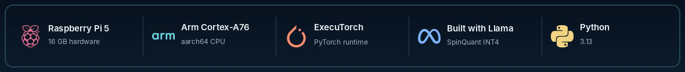

# EdgeShield


EdgeShield helps a user decide what to do with a suspicious text on a Raspberry Pi. A local detector scores the SMS and identifies cues such as urgency or a request for an OTP. The user sees the risk band and recommended action immediately. An optional on-device Llama then explains the cues in plain language.

**Bharat AI-SoC Challenge 2026–27 · PS3 · Open Qualifying · Built with Llama**

## What you can try

| Capability | Status | Evidence |
| --- | --- | --- |
| SMS scam detection | Default CLI mode. Frozen Detector V8 and local Llama exercised offline on a 16 GB Pi 5. Includes English and Hinglish examples. | [Device run](results/pi5/v8-device-20261124/) · [SMS evaluation](docs/V8_EVALUATION_PROTOCOL.md) |
| Phishing URL detection | Experimental CLI mode. Scores the structure of one URL locally without visiting the site. Includes host results and a documented 8 GB Pi 5 trial. | [Prototype and device notes](docs/PHISHING_URL_DETECTION.md) · [Host results](results/host/url_v1/) |
| Network traffic analysis | Phase 2 design for detecting anomalous traffic. Packet acquisition, classifier deployment and device benchmarks are planned. | [Network traffic plan](docs/NETWORK_TRAFFIC_PLAN.md) |

## Try the demos

From the repository root on Linux with Python 3.10–3.13, install the pinned dependencies once. The built-in demos run locally and use a labeled template explanation until you configure the licensed Llama runtime.

```bash
python3 -m venv .venv
. .venv/bin/activate
python -m pip install -r requirements/host.txt
python -m pip install --no-build-isolation --no-deps -e .
edgeshield --demo
edgeshield --mode url --demo
```

For an interactive session, use `edgeshield --repeat` for SMS or `edgeshield --mode url --repeat` for URLs. To run the model-backed demo on a prepared Pi, follow the [Pi 5 deployment guide](docs/PI5_DEPLOYMENT.md) and run `bash deploy/pi5/launch.sh --demo`.

## How an assessment works

1. The detector returns a score and one of three bands, `LEGITIMATE`, `UNCERTAIN` or `SCAM`. A low score cannot establish that a message or site is safe.
2. The application turns observable cues into a typed evidence record. The raw input stays outside the Llama prompt. Application code chooses the recommended action.
3. ExecuTorch runs quantized Llama 3.2 1B locally on the Arm CPU. Accepted output is labeled `Llama (validated)`. If generation is unavailable or fails validation, the user sees `Template fallback`.



## Results and their limits

| Measurement | Recorded result | Where to verify |
| --- | --- | --- |
| V8 SMS detector latency | **1.80 ms median** on the 16 GB Pi 5. Full advisory response took **6.51 s median** and **6.85 s p95** across five requests. | [Benchmark JSON](results/pi5/v8-device-20261124/v8_offline_benchmark.json) |
| Offline advisory | **5/5** explanations passed validation with zero fallbacks. Ethernet and Wi-Fi were down. The trace contained zero IPv4/IPv6 socket matches during the recorded run. | [Device evidence and trace](results/pi5/v8-device-20261124/) |
| V8 synthetic SMS holdout | **238/240 correct**. Of 120 scams, 119 were flagged and one was uncertain. One of 120 legitimate messages was flagged. The evaluation excluded 24 ambiguous examples. | [Evaluation results](results/host/v8/v3_v5_v6_v7_v8_evaluation.json) |
| URL temporal test | **267/477** positive URLs flagged (**55.97% recall**). Another 113 were uncertain and 97 received the legitimate band. The separate curated holdouts use different samples. | [URL evaluation](results/host/url_v1/evaluation_report.json) |

Synthetic evaluation does not establish real-world accuracy. Explanation validation checks whether the wording follows the evidence. Human clarity testing and sustained thermal testing of V8 remain open. The earlier sustained V2 run reached **83.7 °C** under passive cooling. [Limitations](docs/LIMITATIONS.md)

## Verify the submission

Use the activated environment above and install GNU time for the thermal-trial integration test (Debian/Ubuntu package `time`). Run from the repository root. The first command checks the frozen V8 detector and seven files from the recorded Pi run.

```bash
sha256sum -c results/pi5/v8-device-20261124/SHA256SUMS
python -m pytest -q
python scripts/package_bundle.py --source-only
```

| Review material | Location |
| --- | --- |
| Technical report and architecture | [Report](docs/REPORT.md) · [Architecture](docs/ARCHITECTURE.md) · [Privacy](docs/SECURITY.md) |
| Training data and evaluation | [Data provenance](docs/SOURCES_DATA.md) · [V8 protocol](docs/V8_EVALUATION_PROTOCOL.md) |
| Hardware setup and model access | [Pi 5 deployment](docs/PI5_DEPLOYMENT.md) · [ExecuTorch setup](docs/EXECUTORCH.md) |
| Project and submission status | [Engineering evidence](PROJECT_STATUS.md) · [Submission checklist](submission/CHECKLIST.md) |

Original EdgeShield code is distributed under the [project license](LICENSE). Meta Llama weights and tokenizer require separate access and are excluded from the public bundle. [Third-party runtime sources](docs/SOURCES_RUNTIME.md)
