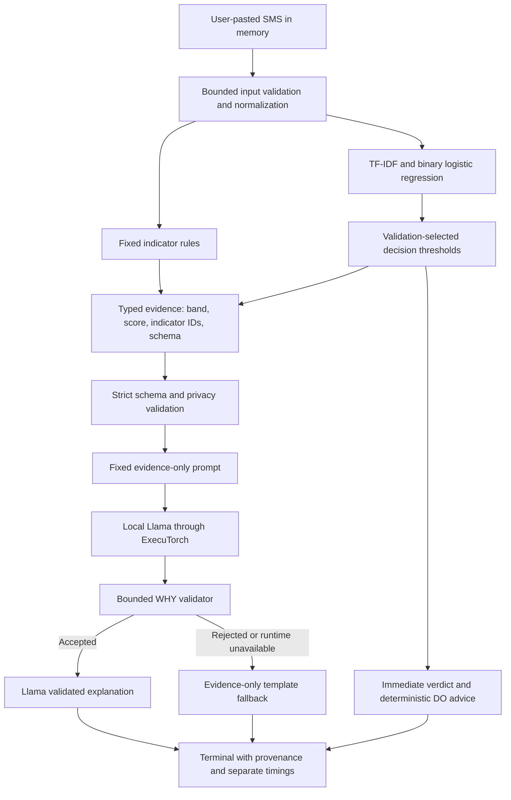

# EdgeShield architecture

Private intelligence. Safer decisions.

EdgeShield is a local terminal application for user-selected SMS. The detector determines the score and decision independently. A Llama advisory backend may explain structured evidence, while application code chooses the security advice. See `PROJECT_STATUS.md` for executed status; this document describes the intended component contract and its tradeoffs.

## Component boundaries

Input handling accepts text, limits size, normalizes Unicode and prevents terminal control sequences from becoming output. It does not access an inbox. Raw text exists in application memory for classification; no message history or database is needed.

The detector uses a binary training target and returns a numerical model score. Two validation-selected thresholds create the three display bands `LEGITIMATE`, `UNCERTAIN` and `SCAM`. `UNCERTAIN` is abstention, not a learned third label. A spam-trained model is a proxy for scam detection and must be described that way. Calibration is optional and must be justified by training/validation evidence.

Indicator rules identify observable textual cues. Names inherited from the brief, such as `BANK_IMPERSONATION`, do not establish actual impersonation. Their descriptions must use cautious wording. OTP notifications and KYC terminology alone do not establish a threat. Rules supply explanatory context, not hardcoded verdicts for demo samples.

The evidence boundary accepts only versioned schema fields, enumerated indicator IDs, a finite bounded score and a valid band. No arbitrary string field, token excerpt, URL, sender, account or message identifier passes into the Llama prompt. Serializing a dictionary is insufficient without validating its keys and values first.

The advisory process receives only the approved prompt. Model, tokenizer and executable identity are checked against an explicit manifest. The adapter invokes a local process without a shell and bounds execution time and output. Provisioning may use the internet; message analysis must not depend on it. Runtime failure does not suppress the detector verdict or the advice.

The explanation validator in `src/edgeshield/validator.py` accepts exact approved lines: a band-specific prefix, optionally followed by one supported indicator description. It does not permit arbitrary paraphrases. This intentionally narrow language reduces freedom and may reject many genuine model responses. It checks the `WHY:` format, length, supported evidence and band consistency. The output source remains visible. A successful fallback is not evidence that Llama ran.

The recommendation is selected from an application-owned allowlist by band. The system does not click, delete, reply, forward, send or remediate automatically. A low score is not sender authentication.

## Local interfaces and storage

Python library calls connect components; no HTTP API, server, database or container is required. `pipeline.assess` returns the evidence, advice and detector/evidence timings; `pipeline.explain` separately returns the accepted or fallback explanation, provenance, reason code and advisory/validation timings. This separation lets the CLI flush detection before starting the advisory call. Repeated terminal input is sequential, so another input waits for the bounded advisory call to finish.

Detector artifacts and runtime configuration live on disk. Evaluation outputs contain synthetic/public-corpus aggregate results and timings. User SMS text is not part of normal telemetry. Model output is treated as untrusted and is not displayed before validation. Interactive input uses hidden terminal entry; `--stdin` accepts one bounded message, and `--json` emits a detection event followed by an explanation event without message text.

No persistent message hash is needed. Such hashes can be dictionary-attacked for common SMS and would create avoidable correlation risk. Terminal scrollback, shell history, swap and OS crash dumps are outside a simple application's no-history guarantee; use interactive input and a trusted local account.

## Host and target split

Python/scikit-learn detection is separate from ExecuTorch. Linux export and compatible runtime builds are a provisioning activity. Raspberry Pi deployment uses a fresh Arm64 environment, matching model/tokenizer/runtime assets and target dependency checks. Never copy a Windows virtual environment or claim x86 binaries run on Arm.

The initial subprocess design may reload weights for each message. Persistence should be added only after proving a supported runner interface and measuring benefit. A bounded process makes timeout isolation straightforward but does not guarantee low latency. Supported thread settings, quantization, CPU instructions and actual Pi memory usage require device evidence.

## Scope and product decisions

Phase 1 targets pasted SMS. Independent URL classification, network capture/intrusion detection, malware behavior analysis, automatic SMS integration and a dashboard are deferred. Link presence in an SMS is not URL reputation analysis. The architecture can accept future structured evidence providers, but they need their own datasets, tests and performance measurements.

The intended audience is a non-expert reviewing a suspicious request. Commercial deployment would require representative consented data, multilingual evaluation, usability evidence, maintenance and independent security assessment. None of those follows automatically from a hackathon prototype.
