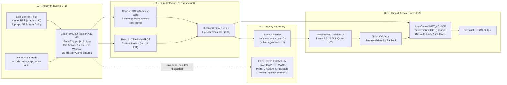

# EdgeShield Pillar 3: Phase 2 Network Traffic Anomaly & Intrusion Detection Plan (`--mode net`)

**Bharat AI-SoC Challenge 2026–27 · Problem Statement 3 (PS3) · Phase 2 Blueprint**  
**Status:** `DESIGNED (NOT_IMPLEMENTED BY DESIGN IN PHASE 1)` · **Built with Llama**

> [!IMPORTANT]
> **Scope & Honesty Notice (`NOT_IMPLEMENTED BY DESIGN`):** Zero live or offline network-capture intrusion detection code (`NetDetectorV1`, `--mode net`, or `models/net_detector_v1.json`) is implemented in Phase 1. Phase 1 delivers offline **Scam SMS Detection (`DetectorV8`)** verified on a physical **Raspberry Pi 5 (16 GB)** alongside an **in-progress** standalone **Phishing URL Detection prototype (`UrlDetectorV1`)** evaluated on a separate **Raspberry Pi 5 (8 GB)**. All throughput, latency, memory, and FPR figures in Sections 2–4 below for `NetDetectorV1` are **engineering design targets and verification gates**, not measured Phase 1 runtime results.

---

## 1. Strategic Positioning Across All Three PS3 Pillars

EdgeShield unifies all three Problem Statement 3 threat surfaces behind one shared typed privacy boundary (`src/edgeshield/evidence.py`), one on-device reasoning model (`Llama-3.2-1B-Instruct-SpinQuant_INT4_EO8` via ExecuTorch XNNPACK), and one deterministic explanation validator (`src/edgeshield/validator.py`):

| PS3 Threat Surface | Module & Artifact | Current Status | Dataset & Validation Scope | Raspberry Pi 5 Evidence / Design Budget |
| :--- | :--- | :--- | :--- | :--- |
| **1. Scam SMS / Smishing** *(Primary Workflow)* | `DetectorV8` `detector_v8.py` `detector_v8.json` | ✅ **COMPLETE & VERIFIED** | UCI SMS Spam + family-disjoint English/Hinglish banking, OTP, UPI, delivery & KYC holdouts (`v8_holdout`: **99.17%** acc, **0.83%** FPR) | Physical **Pi 5 (16 GB)** offline verified (`0` `AF_INET`/`AF_INET6` syscalls, **1.80 ms** med detector, **6.51 s** med full Llama, `5/5` & `91/91` validated, **1.44 GB** RSS, `0 B` swap) |
| **2. Phishing URLs** *(Prototype Branch)* | `UrlDetectorV1` `feat/phishing-url` `url_detector_v1.json` | 🚧 **IN PROGRESS (BENCHMARKED)** | 30 timestamped OpenPhish snapshots (temporal `1,881`: **55.97%** `SCAM` recall, **1.35%** FPR, `0.93168` ROC-AUC) + separate general (`200`: **99.50%**) & Indian (`75`: **100%**) holdouts + `139`-URL stress suite | Physical **Pi 5 (8 GB)** prototype evaluated (`82/82` unit tests, **1.10–1.15 ms** med detector, `4/4` Llama `ACCEPTED` ~`6.286 s`, `1.34 GiB` RSS, `0` swap, `0` pkts in 45 s no-Chromium `tcpdump`, `0` matched `strace` syscalls) |
| **3. Network Traffic** *(Phase 2 Blueprint)* | `NetDetectorV1` `--mode net` `net_detector_v1.json` | 📐 **DESIGNED (`NOT_IMPLEMENTED`)** | DistriNet-corrected CICIDS2017 + UNSW-NB15 via Extended NetFlow (`NF-v2`), NSL-KDD baseline-only sanity, + consented Indian LAN calibration | Planned around measured Pi 5 Cortex-A76 CPU budget (`Cores 0–1` C-ring flow sensor; `Cores 2–3` coalesced Llama advisory) |

---

## 2. Dataset Forensics, Anti-Shortcut Protocol & Indian Edge LAN Realities

Peer-reviewed NIDS research shows that naive pipelines combining pure-Python `Scapy` with `RandomForest` trained on raw NSL-KDD / CICIDS2017 / UNSW-NB15 routinely fail outside lab packet captures. EdgeShield's Phase 2 data pipeline addresses four documented failure modes upfront:

### 2.1 Dataset Forensics & Alignment with Challenge Guidance

1. **Restricting NSL-KDD to a Pipeline Sanity Baseline:** Derived from 1998 DARPA traces, NSL-KDD predates TLS 1.3, QUIC/HTTP3, DNS-over-HTTPS, mobile CGNAT, and modern IoT multicast. EdgeShield restricts NSL-KDD strictly to a historical regression/sanity baseline and never uses it to claim modern intrusion accuracy.
2. **Fixing Raw CICIDS2017 Corruption (Engelen et al., IEEE SPW/WTMC 2021):** Unpatched `CICFlowMeter` introduced broken TCP termination ("TCP appendices"), forward/backward direction inversions, and over 20% mislabeled or corrupted traces (zero-duration `Infinity` byte rates and ambiguous `Attempted` rows). Phase 2 ingests DistriNet-regenerated CICIDS2017 flows and screens boundary counters prior to training.
3. **Harmonizing CICIDS2017 & UNSW-NB15 via Header-Only Bidirectional Flows (Sarhan et al., 2022):** Raw CICIDS2017 (~78 features) and UNSW-NB15 (49 Argus/Bro-IDS features) use incompatible schemas and heavy L7 dissectors that break on encrypted TLS 1.3. Following `NF-UNSW-NB15-v2` / `NF-CICIDS2017-v2`, EdgeShield maps both into a unified **28-feature encryption-agnostic L3/L4 header-only schema** plus sliding-window behavioral features, enabling zero-shot cross-dataset evaluation.
4. **Eliminating Spurious Shortcut Learning (Arp et al., USENIX Security 2022 — Pitfall 4):** Naive models achieve inflated >99% lab accuracy by memorizing testbed attacker IPs, fixed timestamps, and synthetic UNSW-NB15 Time-to-Live values (`sttl`, `dttl`, `ct_state_ttl`). `NetDetectorV1` hard-drops all IP addresses, flow IDs, timestamps, raw source ports, and TTL columns, buckets destination ports into **7 functional service groups**, and enforces strictly chronological and host-disjoint `train` / `calibration` / `validation` / `test` splits.

### 2.2 Indian Home, SME & Campus LAN False-Positive Mitigations

Just as legitimate Indian transactional SMS shares vocabulary with smishing, everyday Indian residential and campus traffic triggers lab-trained NIDS rules:

| Legitimate Indian Edge Traffic | Why Lab-Only Models False-Trigger | Planned EdgeShield Mitigation (`NetDetectorV1`) |
| :--- | :--- | :--- |
| **UPI / Mobile Banking Polling** *(PhonePe, GPay, BHIM, bank apps)* | Rapid short TLS 1.3 bursts + DNS lookups during QR status polling mimic Web Brute Force or Bot callbacks | Model bidirectional TLS handshake completion (`SYN -> SYN-ACK -> ACK` ratio ~`1.0`) and human inter-burst irregularity vs. fixed-jitter C2 beacons |
| **Indian ISP CGNAT & IPv6 Rotation** *(JioFiber, Airtel Xstream, mobile hotspots)* | Carrier-Grade NAT (`100.64.0.0/10`) and IPv6 rotation multiplex many sessions per uplink | Zero IP-reputation reliance; score per-5-tuple flow symmetry and local LAN neighbor fan-out rather than WAN NAT concentration |
| **WhatsApp / Meet / Zoom** *(WebRTC)* | Sustained 50–250 pkt/s small-packet bidirectional UDP streams trigger naive UDP Flood detectors | Measure bidirectional packet ratio (`in_pkts / (out_pkts + 1)`) and jitter stability—real-time media is symmetric (~1:1), unlike one-way floods |
| **Smart-TV, Printer & IoT Discovery** *(mDNS `5353`, SSDP `1900`, ARP)* | Periodic multicast/broadcast UDP announcements resemble Reconnaissance sweeps | Explicit `is_multicast_or_broadcast` and `LAN_DISCOVERY` service buckets separate routine discovery from unicast port sweeps |
| **OTT Streaming & CDN OTA Updates** | High-volume asymmetric inbound TCP/QUIC bursts mimic DoS Hulk or amplification | Condition volumetric cues on client-initiated handshake + healthy ACK progression vs. unrequested/half-open amplification bursts |

> [!NOTE]
> **Consent-Based Local Benign Calibration Protocol:** Benign local threshold calibration will be collected exclusively on an isolated team-owned lab VLAN with written consent, **`snaplen=96` kernel BPF truncation** (physically discarding L7 payloads before user space), and immediate discarding of IP/MAC identifiers during feature extraction.

---

## 3. EdgeShield-Native System Architecture (`--mode net`)

EdgeShield's existing core (`pipeline.py`, `evidence.py`, `validator.py`, `advisory.py`) uses domain-agnostic prefix validation, so `--mode net` plugs into the same `Evidence` boundary without modifying `llama3_2.pte` or `llama_main`:

### 3.1 Stage 00: C-Ring Flow Capture vs. Pure-Python `Scapy`

- **Why not `Scapy`:** Pure-Python `Scapy` allocates nested Python packet objects under the GIL, saturating a Raspberry Pi 5 Cortex-A76 core around ~5k–15k pkt/s (<50 Mbps) and dropping packets during SYN/UDP floods precisely when monitoring is needed most.
- **Two-Tier Capture:**
  1. **Unprivileged Audit Mode (`--mode net --pcap` / `--net-stdin`):** Replays offline `.pcap` traces or structured flow records deterministically without `root` or `CAP_NET_RAW`.
  2. **Live Sensor Mode (`--iface eth0`):** Uses a kernel BPF filter with `snaplen=96` bytes over `libpcap`/`NFStream` CFFI rings pinned to **Cores 0–1**.
- **Bounded Memory & Early Trigger:** A fixed `16,384`-entry LRU 5-tuple hash table (`<= 32 MB` RAM) maintains running Welford statistics in `O(1)` space per flow and emits an early sub-flow vector at packet `k = 8` alongside `15 s` active / `5 s` idle rollups.

### 3.2 Stage 01: 28-Feature Schema & Zero-Pickle Dual-Head `NetDetectorV1`

- **28 Header-Only Features (`0` IP / TTL / Timestamp Shortcuts):** Directional volume & symmetry (`8`), packet-size dispersion (`4`), timing/cadence including inter-arrival coefficient of variation (`6`), protocol/service bucket & TCP handshake progression (`6`), and 2-second sliding-window peer fan-out (`4`: `unique_dst_ports_2s`, `unique_dst_hosts_2s`, `half_open_syn_rate_2s`, `failed_conn_ratio_2s`).
- **Head 1 (Supervised):** JSON-exported `HistGradientBoostingClassifier` (`scikit-learn==1.7.2`, `max_iter=150`, Platt-calibrated) saved to `models/net_detector_v1.json` (~`500 KB` target, `.sha256` verified, zero `pickle`/`joblib`).
- **Head 2 (Unsupervised Zero-Day Gate):** Per-protocol Ledoit-Wolf shrinkage Mahalanobis distance (~`12 KB` precision matrices). If Head 1 scores a flow `LEGITIMATE` but Mahalanobis distance exceeds the 99.5th benign percentile, the verdict escalates to `UNCERTAIN` with `ANOMALOUS_FLOW_PROFILE` to prevent silent zero-day false reassurance.

### 3.3 Closed Network Cue Vocabulary (Compatible with `validator.py`)

Every proposed cue uses pure ASCII, zero digits, and `<= 19` words so `validate_explanation()` accepts them without weakening validation rules:

| Cue ID (`INDICATOR_PRIORITY`) | Exact `DESCRIPTIONS[cue]` String | Observable Trigger Condition |
| :--- | :--- | :--- |
| `SYN_FLOOD_PATTERN` | `Unanswered connection flood activity appears` | High `half_open_syn_rate_2s` with near-zero `SYN-ACK`/`ACK` completion |
| `VOLUMETRIC_AMPLIFICATION` | `Extreme asymmetric inbound traffic bursts appear` | Unsolicited high-pps/byte inbound UDP/ICMP amplification ratio |
| `EXFILTRATION_ASYMMETRY` | `Sustained outbound data transfer spikes appear` | Prolonged high-volume outbound transfer to unfamiliar external endpoint |
| `BRUTE_FORCE_BURST` | `Repeated failed authentication session bursts appear` | Rapid short sessions on admin/auth buckets with high reset/failure ratio |
| `PORT_SCAN_SWEEP` | `Rapid multi-port probing activity appears` | `unique_dst_ports_2s` or `unique_dst_hosts_2s` exceeds benign LAN threshold |
| `PERIODIC_BEACON_CADENCE` | `Regular automated callback timing patterns appear` | Repeated outbound micro-flows with near-zero inter-arrival CV |
| `SLOW_STALL_SESSION` | `Prolonged low-rate connection holding activity appears` | Long-lived open TCP flow with minimal byte progression (Slowloris-style) |
| `ANOMALOUS_FLOW_PROFILE` | `Unusual protocol timing or packet size patterns appear` | Mahalanobis OOD distance exceeds 99.5th benign protocol percentile |

### 3.4 Stage 03: Episode Coalescing, Thermal Safety & Human-in-the-Loop Advice

- **Preventing Alert-Storm Self-DoS:** Measured Pi 5 benchmarks show `~6.51–6.70 s` median per Llama call and `83.7 °C` passive thermal throttling (`throttled=0xe0008`) under 10-minute continuous LLM load (archived B0 sustained SMS run). An `EpisodeCoalescer` groups elevated/uncertain flows sharing `(band, primary_cue)` over a `30 s` window into **1 Incident Episode**, invoking `ExecuTorchAdvisor` (`cpu_threads=2` pinned to **Cores 2–3**) at most once per episode while `--advisory-policy elevated` skips routine benign traffic.
- **No Auto-Blocking (`NET_ADVICE`):** Because spoofed UDP/SYN packets can forge a router gateway or bank IP, autonomous `iptables` blocking creates a self-lockout weapon. App-owned deterministic `NET_ADVICE` guides users to check their router admin console or inspect local devices safely.

---

## 4. Planned Evaluation Gates & Phase 2 Roadmap (Target: 5 February 2027)

These are **planned engineering deliverables and acceptance gates**, not completed tests:

- **Offline Model Baselines & Ablations:** Compare Majority-Class (`NSL-KDD` sanity), Platt-calibrated `LogisticRegression`, and dual-head `NetDetectorV1` (with 95% bootstrapped CIs) across: (A) Chronological DistriNet-CICIDS2017, (B) Host-disjoint `NF-UNSW-NB15-v2`, (C) `TTL`/port shortcut ablation + zero-shot cross-dataset transfer, and (D) Consented Indian lab VLAN stress suite (design target: `< 0.5%` benign FPR).
- **Physical Pi 5 Port-Mirror Gate:** Replay a `10,000`-flow mixed PCAP offline (`eth0`/`wlan0` `DOWN`, `strace` `0` `AF_INET`/`AF_INET6` syscalls), targeting `< 0.5 ms` median per-flow scoring, `< 50 MB` sensor RSS alongside `~1.34 GiB` (`1.44 GB`) Llama child, `0 B` swap, `>= 99%` LLM call suppression via `EpisodeCoalescer`, `100%` validator acceptance, and `< 75 °C` (`throttled=0x0`).

| Milestone & Window | Engineering Deliverable | Planned Verification Gate |
| :--- | :--- | :--- |
| **M1 · Data Harmonization** *(Weeks 1–2 post-Phase 1)* | Ingest DistriNet-CICIDS2017 + `NF-UNSW-NB15-v2` into 28-feature header-only JSONL schema | Automated schema & group-disjoint leakage audit |
| **M2 · Dual-Head Training** *(Weeks 3–4)* | Train JSON `HistGBDT` + Mahalanobis OOD gate; collect consented Indian lab VLAN benign traces; freeze `net_detector_v1.json` | PR-AUC, per-attack recall, `< 0.5%` Indian LAN FPR target, frozen SHA-256 hashes |
| **M3 · Sensor & CLI** *(Weeks 5–6)* | Implement `net_detector.py`, `--mode net --pcap / --iface`, 8 cues in `indicators.py`, and `EpisodeCoalescer` | `pytest` + payload prompt-injection + spoofing self-lockout safety suite |
| **M4 · Pi 5 Port-Mirror Trial** *(Weeks 7–8)* | Pin sensor to Cores `0–1` and Llama to Cores `2–3` on Pi 5; run flood + normal LAN stress test & offline PCAP audit | Checksummed Pi 5 archive (`0` drops target at `100 Mbps`, `0 B` swap, `throttled=0x0`) |

---

## 5. Explicit Limitations of the Phase 2 Network Traffic Design

1. **Not implemented in Phase 1 (`NOT_IMPLEMENTED`):** Zero packet/flow intrusion code exists on `main`. All architecture specs, latency targets, and `< 0.5%` FPR goals are unverified engineering designs.
2. **No Deep Packet Inspection (DPI) or TLS Decryption:** By deliberate privacy design (`snaplen=96`, L3/L4 header features only), `NetDetectorV1` cannot inspect encrypted HTTPS/QUIC application payloads (e.g., SQL injection or malicious web requests hidden inside valid TLS sessions).
3. **Hardware & privilege prerequisites for live sensing:** Passive LAN monitoring across other devices requires managed switch port-mirroring or gateway placement plus `CAP_NET_RAW` / `root` for live capture (unprivileged `--pcap` replay works without privileges).
4. **Advisory only (no autonomous containment):** Excluding auto-blocking protects against spoofed-source self-DoS, leaving isolation decisions to a human operator.
5. **Real-world calibration dependency:** Generalizing from public lab datasets to real Indian broadband/CGNAT environments requires the planned consented Indian lab VLAN benign calibration campaign before deployment.
