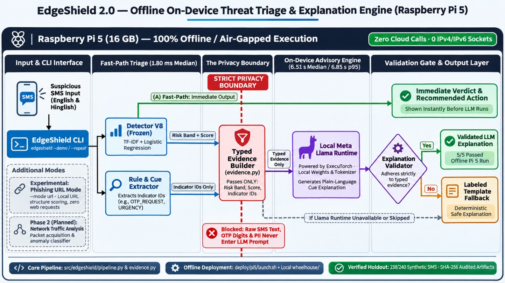

# EdgeShield Technical Report

**Bharat AI-SoC Challenge 2026–27 · Problem Statement 3 (PS3) · Open Qualifying (Phase 1)**  
**Report date:** 24 November 2026 · **Built with Llama**

---

## 1. Executive Summary and Scope

EdgeShield is a local, terminal-first SMS scam risk assistant designed to run entirely offline on a CPU-only **Raspberry Pi 5**. It addresses a practical safety challenge for everyday mobile users: legitimate OTPs, banking alerts, payment notices, and delivery updates often share vocabulary with social-engineering scams, so users need both a fast risk signal and plain-language reasoning without uploading private messages to the cloud.

EdgeShield enforces a strict architectural separation between **detection**, **explanation**, and **action**:

- **Independent Statistical Detection:** A lightweight word + character TF-IDF logistic-regression detector (`models/detector_v8.json` default candidate, SHA-256 `4d3481555460d2bf5dfaf5e28fc107786f38ea34400358e4637b5bd9b0afd365`, thresholds `[0.55, 0.675]`; archived Pi 5 B0 Llama run measured `models/detector_v2.json`, ~1.95 MB JSON, SHA-256 `f37c3dd9060b89ead7ea6bbf1c393b22fff7cfc18ed5d85126e977e03daea6a6`) scores pasted SMS locally on CPU, paired with clause-level lexical cue rules (`src/edgeshield/indicators.py`) that never override statistical scores.
- **Typed Privacy Boundary:** Only a validated `Evidence` object (threat band, numeric score, and enumerated cue IDs) crosses to the LLM prompt (`src/edgeshield/evidence.py`). Raw SMS text, sender numbers, account strings, and URLs are never exposed to the language model.
- **On-Device Llama Reasoning via ExecuTorch:** Meta `Llama-3.2-1B-Instruct-SpinQuant_INT4_EO8` executes locally on the Raspberry Pi 5 CPU through ExecuTorch (XNNPACK backend, `pi5-cortex-a76-native` runner, 2 CPU threads) to produce a short `WHY:` explanation.
- **Controlled Validation & Deterministic Advice:** Every LLM output passes a strict validator (`src/edgeshield/validator.py`). Unaccepted, timed-out, unavailable, or policy-skipped generations fall back to an explicitly labeled `Template fallback`. Application code—never the LLM—supplies every `DO:` recommended action (`src/edgeshield/recommendations.py`).

**Multi-Surface PS3 Scope:** Following the official challenge brief and PS3 mentoring guidance (slides 03 and 11), Phase 1 delivers **Scam SMS Detection (`DetectorV8`)** as the complete, hardware-verified offline primary workflow on a physical Raspberry Pi 5 (16 GB) (`--mode sms`, default). In addition, **Section 7** transparently reports our **in-progress** standalone **Phishing URL Detection prototype (`UrlDetectorV1`, `--mode url`)** — now included on `main` ([PHISHING_URL_DETECTION.md](PHISHING_URL_DETECTION.md), host artifacts in `results/host/url_v1/`) and benchmarked on a physical Raspberry Pi 5 (8 GB) — together with our **Phase 2 Network Traffic Anomaly & Intrusion Detection Plan (`NetDetectorV1`, `NOT_IMPLEMENTED`, [NETWORK_TRAFFIC_PLAN.md](NETWORK_TRAFFIC_PLAN.md))** and explicit limitations across all three PS3 surfaces. Malware behavior analysis remains future scope.

---

## 2. System Architecture and Safeguards

Full component boundaries and threat modeling are detailed in [ARCHITECTURE.md](ARCHITECTURE.md) and [SECURITY.md](SECURITY.md).



*Figure 1. EdgeShield’s on-device workflow. The latency and network measurements refer to the [recorded offline Raspberry Pi 5 run](../results/pi5/v8-device-20261124/).*

Key safety properties verified by automated tests (`261 passed, 0 failed` on Ubuntu x86_64 host, 20 Nov 2026; `tests/test_safety.py`, `tests/test_runtime.py`, `tests/test_pipeline_integration.py`, `tests/test_packaging.py`):

- **Prompt-injection isolation:** Because raw SMS text cannot cross the `Evidence` boundary, adversarial instructions inside an SMS cannot reach the Llama prompt.
- **Integrity-checked bounded subprocess:** `ExecuTorchAdvisor` (`src/edgeshield/advisory.py`) verifies SHA-256 digests of the runner, `.pte` model, tokenizer, and shared libraries before every invocation, clears preload environment variables, executes without a shell, enforces wall-clock timeout and stdout/stderr byte caps, and sanitizes runtime errors before returning fallback output.
- **Advisory policy:** `--advisory-policy {always,elevated,uncertain,off}` defaults to `always` and optionally skips Llama on clean low-risk messages (`elevated`), labeling skipped outputs explicitly (`SKIPPED_BY_POLICY`).
- **No persistence:** Interactive mode hides pasted SMS input; EdgeShield does not save message history, access SMS inboxes, or take automated remediation actions.

---

## 3. Verified Physical Raspberry Pi 5 Configuration and Provenance

### 3.1 Target Hardware and OS

Verified directly from physical device captures in `results/pi5/archive/20261118-B0-full/environment.json` and `diagnostics.txt`:

| Property | Verified Value |
|---|---|
| Device | Raspberry Pi 5 Model B Rev 1.1 (CPU-only, open board, passive heatsink) |
| Architecture | `aarch64` (64-bit Arm Cortex-A76) |
| RAM / Swap | 16 GB (`16,603,456 KiB` visible RAM); 2 GiB zram swap configured (`0 B` used during runs) |
| Operating System | Debian GNU/Linux 13 (`trixie`, 13.7), Kernel `6.18.50+rpt-rpi-2712` |
| Python / C Library | Python `3.13.5`, `glibc 2.41` |

### 3.2 Model and ExecuTorch Runtime Provenance

| Artifact | Provenance & Verified SHA-256 |
|---|---|
| Upstream Checkpoint | `meta-llama/Llama-3.2-1B-Instruct-SpinQuant_INT4_EO8`, Hugging Face revision `b8c08c95d0476ccb6fc86e9410818d602ecca19d` (`consolidated.00.pth` SHA-256 `c14adb6bf48fd9e81fdc14ebad5ef0ea9f98d50ca3419b28f0b788149c4ef2a5`) |
| Exported Model (`llama3_2.pte`) | Exported via pinned ExecuTorch `985c1ceccc8bb8b6a32294f71aeb5d2f299562f7` (`release/1.5`, SpinQuant INT4 EO8, XNNPACK CPU backend); `1,075,142,912` bytes (~1.00 GiB), SHA-256 `c31e4d376f349de85b4422a8c0405d88f21145709f0e17168b06d809ffe5e8a2` |
| Tokenizer (`tokenizer.model`) | Meta Tiktoken tokenizer (`2,183,982` bytes), SHA-256 `82e9d31979e92ab929cd544440f129d9ecd797b69e327f80f17e1c50d5551b55` |
| Runner Profile | `pi5-cortex-a76-native` (`pi5-aarch64`, Arm GNU Toolchain `12.2.rel1`, `GLIBC <= 2.34`, `cpu_threads=2`, `max_new_tokens=48`, greedy decoding) |
| Runner Binaries | `models/llama/pi5-aarch64/llama_main` (SHA-256 `e628abef24091067f4954b4ea15ce84317570d6d99e2ddc34a3786af7ad8d70c`) and `libllama_runner.so` (SHA-256 `d45f39fd3b7f53bb511190fedab971933d176a3431c73f53f9fd87ad39496731`) |
| Production Manifest | Two-thread Pi 5 manifest (`runtime_config_sha256`: `a4f1f80bdcb995ec6d647d436d0ab3ba197380e3a82965501ed8286a7cef18c0`) |
| Frozen Detector V2 (archived Pi 5 B0 sustained Llama run) | `models/detector_v2.json` (`edgeshield-word-char-lr-v2`, SHA-256 `f37c3dd9060b89ead7ea6bbf1c393b22fff7cfc18ed5d85126e977e03daea6a6`, `thresholds: [0.25, 0.275]`) |
| Frozen Detector V8 (current CLI/RC default; Pi 5 offline Llama & detector verified) | `models/detector_v8.json` (`edgeshield-word-char-lr-v8`, SHA-256 `4d3481555460d2bf5dfaf5e28fc107786f38ea34400358e4637b5bd9b0afd365`, `thresholds: [0.55, 0.675]`) |

---

## 4. Measured Physical Raspberry Pi 5 Performance (Archived B0 — Detector V2 `f37c3dd9...`)

All 12 files in `results/pi5/archive/20261118-B0-full/` pass `sha256sum -c SHA256SUMS` and are preserved untouched (`detector_sha256: f37c3dd9060b89ead7ea6bbf1c393b22fff7cfc18ed5d85126e977e03daea6a6`, V2). Benchmarks execute 5 fixed synthetic fixtures to measure system latency, memory, stability, and explanation validation—never detection accuracy. Current offline **V8 (`4d348155...`) + ExecuTorch Llama** verification and offline detector/pytest verification on Raspberry Pi 5 (16 GB) are complete and documented in **Section 5** (`results/pi5/v8-device-20261124/` and `results/pi5/v8-offline-20261124/`).

| Metric | Measured Pi 5 Result | Workload & Source File |
|---|---|---|
| Smoke test (4-case English + Hinglish CLI) | **4/4** `Llama (validated)`, **2/2** labeled `Template fallback` | `smoke_test.txt`, `fallback_smoke.jsonl` |
| Detector inference latency (detector-only) | **0.89 ms** median · **0.92 ms** p95 · 1.12 ms max | `n=100` detector-only samples (`benchmark-detector.json`) |
| Short full-pipeline run | **5/5** validated (0 fallbacks) · **6.64 s** median · **6.69 s** p95 · max 70.0 °C (`throttled=0x0`) | `n=5` full requests (`benchmark-short.json`) |
| Sustained full-response latency (B0) | **6.70 s** median · **6.81 s** p95 · 6.91 s max | `n=91` sustained requests over 605.4 s (`benchmark.json`) |
| Sustained detector latency (under load) | **1.63 ms** median · **1.73 ms** p95 | `n=91` requests (`benchmark.json`) |
| Runtime model load time (cold per call) | **1.22 s** median · **1.25 s** p95 | Pinned runner counters (`benchmark.json`) |
| Runtime TTFT (excludes model load) | **3.20 s** median · **3.43 s** p95 | Pinned runner counters, includes tokenizer + prefill (`benchmark.json`) |
| Decode throughput | **13.49 tokens/s** median · **13.77 tokens/s** p95 | Pinned runner counters (`benchmark.json`) |
| Sustained explanation validator acceptance | **91/91** accepted (**0 fallbacks**, 0.0% fallback rate) | `n=91` requests over 605.4 s (`benchmark.json`) |
| Peak runner child RSS | **1.44 GB** decimal (**1.34 GiB**, `1,443,217,408` bytes; GNU time `1,409,392 KiB`) | `benchmark.json` (`RUSAGE_CHILDREN`), `process-resources.txt` |
| Swap usage / min available RAM | **0 bytes** swap used (`Swaps: 0`) · 15.83 GB min available RAM | `benchmark.json`, `process-resources.txt` |
| Thermals & throttling (passive heatsink) | Start 59.3 °C (`0x0`) → Peak **83.7 °C** (p95 82.6 °C) → `throttled_after=0xe0008` | Open board, passive heatsink (`benchmark.json`, `system-before.txt`, `system-after.txt`) |

### Sustained V8 operation

The physical Pi 5 completed five offline V8 requests over 48.18 seconds. A ten-minute V8 run was unavailable before submission. The earlier V2 run provides a comparison for continuous use on a passively cooled Pi 5.

| Measured on the Pi 5 | V8 offline run | V2 sustained run |
| --- | ---: | ---: |
| Requests / elapsed time | 5 / 48.18 s | 91 / 605.4 s |
| Full response, median / p95 | 6.51 / 6.85 s | 6.70 / 6.81 s |
| Validated explanations | 5/5 | 91/91 |
| Peak temperature | 72.7 °C | 83.7 °C |
| End-of-run throttle flags | `0x0` | `0xe0008` |

**Engineering assessment.** Both versions spent seconds generating each advisory and milliseconds scoring the SMS. Their short-response timings make the V2 run relevant when planning repeated V8 inference. The V2 board throttled under continuous load, so thermal throttling is a credible risk for V8 with passive cooling. Five V8 requests provide too little thermal history to estimate a ten-minute peak temperature, time to throttling, or sustained p95 latency.

Recorded evidence: [V8 offline benchmark](https://github.com/mohamedzayn472/EdgeShield2.0/blob/main/results/pi5/v8-device-20261124/v8_offline_benchmark.json) · [V2 sustained benchmark](https://github.com/mohamedzayn472/EdgeShield2.0/blob/main/results/pi5/archive/20261118-B0-full/benchmark.json).

### Cooling, Throttling, and Performance Notes

- **Subprocess reload design:** Each message invokes `llama_main` as an isolated child process, so total wall time (`6.81 s` p95) includes per-call SHA-256 verification, `.pte` model load (`~1.22 s` median), prompt tokenization + prefill (`~3.20 s` median TTFT), and token decode (`13.49 tokens/s` median). The detector verdict and deterministic `DO:` advice appear immediately in `<2 ms` before the advisory call finishes.
- **Disclosed thermal throttling:** Under 10 minutes of continuous back-to-back inference with a passive heatsink on an open board, SoC temperature rose from `59.3 °C` to `83.7 °C` and triggered thermal throttling (`throttled_after=0xe0008`). By contrast, the 5-request short burst (`benchmark-short.json`) peaked at `69.95 °C` with `throttled=0x0`. Active cooling, latency reductions toward an internal 2-second engineering target, and persistent-runner optimizations remain internal engineering work beyond Phase 1.
- **Archived metadata note:** Inside the immutable B0 archive, `benchmark.json` retains the generic script default `hardware_verified_pi5: false` and the pre-run 17 November `STATUS.json` (`4 GB`, `PENDING_HARDWARE`). Those archived files are kept unmodified for SHA-256 integrity; verified Pi 5 execution is established by the matched `environment.json` (`PASSED`, Pi 5 Model B Rev 1.1, 16 GB), `diagnostics.txt`, `smoke_test.txt`, and `benchmark.json`, and is reflected in `results/pi5/STATUS.json`.

---

## 5. Offline Verification Status (`VERIFIED` on V8 + Llama & V8 Detector-Only)

1. **V8 + ExecuTorch Llama Offline Run (`results/pi5/v8-device-20261124/`, `VERIFIED`, 24 Nov 2026):** Checksum-verified (`SHA256SUMS` `8/8 OK`, recorded `2026-11-24T05:27:28Z`, V8 `4d348155...`, `runtime_config_sha256: a4f1f80b...`) on physical Raspberry Pi 5 Model B Rev 1.1 (`16 GB`, Debian 13 Trixie, Python 3.13.5): `eth0` and `wlan0` `DOWN` (`lo` only), empty `offline_routes.json` (`[]`), **0 `AF_INET`/`AF_INET6` matches** in `v8_offline_network.trace`, single CLI SCAM check `Llama (validated)` (`7.76 s`), and 5-request offline benchmark (`48.18 s`) achieving **5/5 `Llama (validated)`** (**0 fallbacks**), **6.51 s** median / **6.85 s** p95 full response (`1.80 ms` med detector, `1.21 s` med load, `3.17 s` med TTFT, `13.25 tok/s` med decode), **1.44 GB** (`1.34 GiB`, `1,443,233,792` B) peak RSS, **0 B** swap, and **72.7 °C** max (`throttled=0x0`).
2. **V8 Detector-Only Offline Batch & Suite (`results/pi5/v8-offline-20261124/`, `VERIFIED`, 24 Nov 2026):** `eth0`/`wlan0` `DOWN`, `pip check` clean, local wheelhouse (`wheelhouse/pi5-cp313-aarch64/`), **`361 passed, 1 skipped`** (`tests/test_detector.py:71` corpus-excluded skip) in `52.35 s`, and `5` repeated batch runs of `10` synthetic messages (`50` total detections: `25 SCAM`, `20 LEGITIMATE`, `5 UNCERTAIN`; `2.4321 ms` avg, `2.2172 ms` min, `5.0981 ms` max) at `63.7 °C` (`throttled=0x0`).
3. **Archived V2 + Llama Offline Run (`results/pi5/offline-20261119/`, `VERIFIED`, 19 Nov 2026):** Checksum-verified (`SHA256SUMS` `6/6 OK`) with **Detector V2 (`f37c3dd9...`)** (`5/5` `Llama (validated)`, `6.80 s` p95, `0` `AF_INET`/`AF_INET6` syscalls).

| Artifact | Audited Finding |
|---|---|
| `interfaces.json` | Loopback (`lo`) only `UP`; `eth0` and `wlan0` `operstate: "DOWN"`, no `UP` flag, `addr_info: []` |
| `routes.json` | `[]` (empty routing table, zero external/default routes) |
| `offline-environment.json` | `status: "PASSED"` (all 11 device/ABI/integrity checks `true`, Pi 5 Model B Rev 1.1, 16 GB; preflight `inference: "NOT_EXECUTED"` precedes the traced benchmark) |
| `network.trace` | Nonempty 58-line `strace -f -e trace=network` trace covering parent Python + all 5 child `llama_main` processes (all exit 0); **zero `AF_INET` / `AF_INET6` matches** (`grep -E` exit `1`) and zero `socket`/`connect`/`sendto`/`recvfrom`/`bind` calls observed |
| `offline-benchmark.json` | **5/5** `Llama (validated)` explanations (**0 fallbacks**, `0.0%` fallback rate); `6.73 s` median / `6.80 s` p95 full response (`1.50 ms` med detector, `1.21 s` med load, `3.19 s` med TTFT, `13.25 tok/s` med decode); `1,442,791,424 B` (`1.44 GB` / `1.34 GiB`) peak runner RSS; `0 B` swap; `73.25 °C` max temp (`throttled=0x0`) |
| `inference.json` | SHA-256 `a4f1f80bdcb995ec6d647d436d0ab3ba197380e3a82965501ed8286a7cef18c0` — exact match to `runtime_config_sha256` in both `offline-benchmark.json` and archived B0 `benchmark.json` |

---

## 6. Detector Evaluation (V2–V8) and Limitations

Detector accuracy is evaluated separately from Llama explanation acceptance. V2 methodology and results are documented in [EVALUATION_V2.md](EVALUATION_V2.md), [V2_FINAL_EVALUATION.md](V2_FINAL_EVALUATION.md), and [V2_RESULTS.md](V2_RESULTS.md) (`results/host/v2/`). V8 pre-registered protocol, OTP/short-number canonicalization, repaired clause-level indicators (`src/edgeshield/indicators.py`), and multi-version identical-row regressions are documented in [V8_EVALUATION_PROTOCOL.md](V8_EVALUATION_PROTOCOL.md) and `results/host/v8/v3_v5_v6_v7_v8_evaluation.json` (all host promotion gates `P1`–`P4` `PASSED`).

| Dataset (Identical Rows) | Version | Acc | Prec | Rec | FPR | Abs | 2×3 Confusion `[[TN,U,FP],[FN,U,TP]]` |
|---|---|---:|---:|---:|---:|---:|---|
| `v8_holdout` (`240`: 120/120; `24` ambig excl.) | V3 (`[0.65, 0.75]`) | 80.42% | 87.85% | 78.33% | — | 5.83% | — |
| `v8_holdout` (`240`: 120/120; `24` ambig excl.) | **V8 (`[0.55, 0.675]`)** | **99.17%** | **99.17%** | **99.17%** | **0.83%** | 0.42% | **`[[119, 0, 1], [0, 1, 119]]`** |
| `v7_holdout` (`240`: 120/120; `24` ambig excl.) | **V8 (`[0.55, 0.675]`)** | **97.08%** | **99.15%** | **96.67%** | **0.83%** | 1.25% | **`[[117, 2, 1], [3, 1, 116]]`** |
| `v6_holdout` (`240`: 120/120; `24` ambig excl.) | **V8 (`[0.55, 0.675]`)** | **100.00%** | **100.00%** | **100.00%** | **0.00%** | 0.00% | **`[[120, 0, 0], [0, 0, 120]]`** |
| `v5_holdout` (`240`: 120/120; `24` ambig excl.) | **V8 (`[0.55, 0.675]`)** | **100.00%** | **100.00%** | **100.00%** | **0.00%** | 0.00% | **`[[120, 0, 0], [0, 0, 120]]`** |
| `v4_holdout` (`240`: 120/120; `24` ambig excl.) | **V8 (`[0.55, 0.675]`)** | **97.08%** | **98.35%** | **99.17%** | **1.67%** | 1.67% | **`[[114, 4, 2], [1, 0, 119]]`** |
| `v3_holdout` (`160`: 80/80) | **V8 (`[0.55, 0.675]`)** | **99.38%** | **100.00%** | **98.75%** | **0.00%** | 0.00% | **`[[80, 0, 0], [1, 0, 79]]`** |
| `v2_holdout` (`120`: 60/60; `12` ambig excl.) | **V8 (`[0.55, 0.675]`)** | **96.67%** | **98.28%** | **95.00%** | **1.67%** | 1.67% | **`[[59, 0, 1], [1, 2, 57]]`** |
| `uci_test` (`1,148`: 984/164) | **V8 (`[0.55, 0.675]`)** | **98.17%** | **100.00%** | **88.41%** | **0.00%** | 0.17% | **`[[982, 2, 0], [19, 0, 145]]`** |
| `indian_sms` test (`24`: 12/12; `4` ambig excl.) | **V8 (`[0.55, 0.675]`)** | **95.83%** | **100.00%** | **100.00%** | **0.00%** | 4.17% | **`[[11, 1, 0], [0, 0, 12]]`** |

On `v8_holdout` (`240` labeled), V8 achieved **0.99993 ROC-AUC** and **0.00857 Brier score**, with `1/120` benign cue errors. Host ExecuTorch Llama validation on V8 passed `3/3` smoke (`results/host/v8/llama_smoke_host.json`) and `264/264` weighted (`221/221` distinct) evidence cases (`results/host/v8/llama_evidence_host.json`). Synthetic holdouts do not establish real-world accuracy; human label review and real-world calibration remain pending.

### 6.1 Data Splits, Leakage Checks, and Threshold Selection

- **Training & validation splits (`results/host/v2/training_validation.json`):**
  - Train: `2,770` UCI SMS Spam Collection messages + `288` synthetic Indian/Hinglish development messages (48 families × 6 variants).
  - Calibration: `543` UCI + `48` synthetic (8 families). Sigmoid calibration reduced macro Brier score from `0.0243` to `0.0129`.
  - Validation: `1,113` UCI + `96` synthetic (16 families). Regularization (`C=4`), synthetic sample weighting (`2`), and decision thresholds (`[0.25, 0.275]`) were selected exclusively on development partitions without seeing the holdout.
- **Leakage & freeze controls (`results/host/v2/data_audit.json`, `evaluation_freeze.json`):**
  - Development family separation passed (`synthetic_development_leakage_check: PASSED`).
  - A separate authoring agent produced `132` fresh fictional holdout messages (`120` labeled + `12` ambiguous) without reading the development corpus or model code.
  - Pre-prediction audit (`canonical` and character 3–5-gram cosine `>= 0.90`) excluded `0` items (`data_audit.json: PASSED`). All model, code, protocol, and dataset SHA-256 digests were frozen (`freeze_sha256: 80d0f852...`) before one-time evaluation; no thresholds were adjusted afterward.

### 6.2 Fresh Synthetic Holdout Results (`n = 120` Labeled; `12` Ambiguous Excluded)

Source: `results/host/v2/heldout_evaluation.json` (reproduced bit-for-bit on Ubuntu in `results/host/ubuntu/v2_reproduction.json`).

| Group | n (Scam / Legit) | Recall (Scams Detected) | False-Positive Rate | Precision | F1 | Abstentions | Confusion Matrix `[[TN, U, FP], [FN, U, TP]]` |
|---|---:|---:|---:|---:|---:|---:|---|
| **Overall** | 120 (60 / 60) | **50/60 (83.33%)** | **1/60 (1.67%)** | **98.04%** | **0.9009** | 0/120 (0%) | `[[59, 0, 1], [10, 0, 50]]` |
| **English** | 60 (30 / 30) | **26/30 (86.67%)** | **0/30 (0.00%)** | 100.00% | 0.9286 | 0/60 (0%) | `[[30, 0, 0], [4, 0, 26]]` |
| **Hinglish** | 60 (30 / 30) | **24/30 (80.00%)** | **1/30 (3.33%)** | 96.00% | 0.8727 | 0/60 (0%) | `[[29, 0, 1], [6, 0, 24]]` |

- **10 missed scams assigned `LEGITIMATE` (false negatives):**
  - English (`4`): `v2h049` (score `0.0183`), `v2h050` (`0.0375`), `v2h056` (`0.0433`), `v2h057` (`0.1789`).
  - Hinglish (`6`): `v2h091` (`0.0338`), `v2h100` (`0.1692`), `v2h102` (`0.0589`), `v2h106` (`0.0632`), `v2h108` (`0.0248`), `v2h118` (`0.1757`).
- **1 false positive assigned `SCAM`:** Hinglish `v2h066` (score `0.2900`).
- **12 ambiguous holdout messages (excluded from scored metrics):** `11` assigned `LEGITIMATE`, `1` assigned `SCAM` (`v2h131`, score `0.9973`), `0` assigned `UNCERTAIN`.
- **Reused UCI regression set (`n = 1,148`, not a fresh holdout):** Recall `148/164` (`90.24%`), Precision `99.33%`, F1 `0.9457`, FPR `1/984` (`0.10%`), confusion matrix `[[983, 0, 1], [16, 0, 148]]`.
- **Preserved V1 failure baseline (`models/detector.json`):** Detected only `1/12` synthetic scams (`0/6` Hinglish; `docs/DETECTOR_FINDINGS.md`). Because V1 and V2 used different synthetic test sets, their percentages are not presented as a controlled before/after comparison.

### 6.3 Advisory Explanation Acceptance (Distinct from Detector Accuracy)

- **Physical Pi 5:** `91/91` (`100%`) validated in B0 sustained run (`benchmark.json`), `5/5` in short run (`benchmark-short.json`), `4/4` in smoke test (`smoke_test.txt`).
- **Ubuntu x86_64 host verification:** `432/432` dev, `132/132` holdout, and `20/20` Llama-vs-template comparison (`results/host/ubuntu/twenty_case_llama_vs_template.json`) after adopting 1-shot defensive framing and `INDICATOR_PRIORITY` salience ordering (`src/edgeshield/validator.py`).
- Validator acceptance confirms strict wording compliance with structured `Evidence`; it **cannot** validate whether the detector's underlying risk verdict is true.

### 6.4 Key Evaluation and Product Limitations

1. **Synthetic & spam-proxy data limits:** The fresh holdout consists of AI-assisted fictional messages and UCI spam serves as a proxy for scams. These metrics do **not** establish real-world Indian SMS fraud accuracy.
2. **False reassurance risk (10 misses, 0 abstentions):** The narrow validation-selected uncertainty band (`[0.25, 0.275]`) produced zero abstentions on the holdout, leaving all 10 missed scams labeled `LEGITIMATE`.
3. **Pending human studies:** Independent human label review of synthetic examples, representative consented real-message evaluation, and the 5-person explanation clarity study (`docs/CLARITY_STUDY_INSTRUMENT.md`) remain pending.
4. The SMS detector is the default. Standalone phishing URL inspection is available as an experimental mode. Network traffic analysis is a Phase 2 design.

---

## 7. Multi-Surface PS3 Progress — Phishing URL Prototype (In Progress) & Phase 2 Network Traffic Plan

### 7.1 Multi-Surface PS3 Status Overview

| PS3 Threat Surface | Component / Branch | Status | Target / Tested Pi 5 Hardware | Evidence / Plan Link |
| :--- | :--- | :--- | :--- | :--- |
| **1. Scam SMS / Smishing** | `DetectorV8` (`main`) | ✅ **COMPLETE & VERIFIED** | Raspberry Pi 5 Model B **16 GB** (`aarch64`, offline `lo` only) | `results/pi5/v8-device-20261124/`, Sections 3–6 |
| **2. Phishing URLs** | `UrlDetectorV1` (`--mode url` on `main`, prototype) | 🚧 **IN PROGRESS (PI 5 BENCHMARKED)** | Raspberry Pi 5 Model B Rev 1.1 **8 GB** (`aarch64`, Debian 13 Trixie `6.18.50+rpt-rpi-2712`, `glibc 2.41`, Python `3.13.5`) | [PHISHING_URL_DETECTION.md](PHISHING_URL_DETECTION.md), `results/host/url_v1/`, USB archive `edgeshield_url_transfer/` (`12/12 OK` URL + `8/8 OK` net) |
| **3. Network Traffic Anomaly & Intrusion** | `NetDetectorV1` (`--mode net`, planned) | 📐 **DESIGNED (`NOT_IMPLEMENTED`)** | Engineered around Raspberry Pi 5 Cortex-A76 core budget (Cores `0–1` sensor, Cores `2–3` Llama) | [NETWORK_TRAFFIC_PLAN.md](NETWORK_TRAFFIC_PLAN.md) |

### 7.2 Phishing URL Detection Progress (In Progress — Pi 5 8 GB Prototype Handover)

An experimental standalone phishing URL prototype (`UrlDetectorV1`, included on `main` under `--mode url` and `models/url_detector_v1.json` for judge inspection while `--mode sms` with `models/detector_v8.json` remains the unchanged Phase 1 default) was deployed and evaluated on a **physical Raspberry Pi 5 Model B Rev 1.1 (8 GB RAM, AArch64, Debian GNU/Linux 13 Trixie, kernel `6.18.50+rpt-rpi-2712`, GLIBC `2.41`, Python `3.13.5`)** inside `~/edgeshield-url` using the shared virtual environment (`~/edgeshield/.venv`). All 12 URL evaluation files (`url-v1-device/SHA256SUMS`: `12/12 OK`) and all 8 network-traffic capture/trace files (`network-traffic/SHA256SUMS`: `8/8 OK`) were checksum-verified on the Pi 5 handover USB (`edgeshield_url_transfer/`).

#### Quantitative Evaluation on Physical Raspberry Pi 5 (8 GB)

| Evaluation Suite | Dataset Size (Neg / Pos) | Accuracy | Precision | Recall (`SCAM`) | FPR | F1 | Abstention | ROC-AUC | Brier | Latency (Med / P95 / Max) |
|---|---|---:|---:|---:|---:|---:|---:|---:|---:|---|
| **Unit Tests** | `82` tests | `82/82` passed (`0` failed, `1.35 s`) | — | — | — | — | — | — | — | — |
| **Stress Test** | `139` (`79` benign / `60` phish + fuzz) | `77/79` benign `LEGITIMATE`, `2` `UNCERTAIN` (`zoom.us`, `localhost:8000`) | — | **`60/60` (`100%`)** hard phish `SCAM` | **`0/79` (`0%`)** benign `SCAM` | — | — | — | — | **`1.1098 ms`** / `1.3329 ms` / `3.2401 ms` |
| **Temporal Evaluation** *(Time-split)* | `1,881` (`1,404` / `477`) | **83.47%** | **93.36%** | **55.97%** *(+`113` `UNCERTAIN`)* | **1.35%** | **69.99%** | **10.37%** | **0.93168** | **0.07891** | **`1.0983 ms`** / `1.2618 ms` / `2.1916 ms` |
| **General Holdout** *(Separate set)* | `200` (`100` / `100`) | **99.50%** | **100%** | **100%** | **0%** | **100%** | **0.50%** | **1.000** | **0.00286** | **`1.1019 ms`** / `1.3278 ms` / `3.4057 ms` |
| **Indian Holdout** *(Separate set)* | `75` (`25` / `50`) | **100%** | **100%** | **100%** | **0%** | **100%** | **0%** | **1.000** | **0.00068** | **`1.1501 ms`** / `1.3762 ms` / `1.4396 ms` |

- **Temporal confusion matrix (`1,881`):** `[[1303, 82, 19], [97, 113, 267]]`. Stress security checks additionally verified `14/14` malformed URLs rejected, `11/11` policy-bypass checks passed, `0` prompt-injection sentinel leaks, and `0` network calls attempted.
- **On-device Llama Runtime & Resources (`Pi 5 8 GB`):**
  - **4-scenario URL demo** (legitimate SBI, phishing SBI subdomain, legitimate NPCI, numeric-IP `.apk` phishing): **`4/4` Llama response `Validated / ACCEPTED`**, average detector latency **~`2.20 ms`**, average Llama inference **~`6.286 s`**.
  - **Single phishing URL (`http://sbi.kyc-verify-account.xyz/netbanking/login.php?session=9281`):** `SCAM` (score `0.9999996315941981`, `3.1838 ms` detector, `0.1566 ms` evidence), **`Validated / ACCEPTED`** (`6,652.0643 ms` Llama inference, `0.5261 ms` validation). *(Here `ACCEPTED` refers strictly to validator acceptance of the Llama response, never that the URL is safe.)*
  - **Measured process resources:** User CPU `40.89 s`, System CPU `1.98 s`, Elapsed `27.04 s` (`158%` CPU), Max RSS **`1,409,328 KB` (~`1.34 GiB`)**, Swap used `0`, Socket messages sent `0` / received `0`, exit `0`; temperatures `~52–66 °C` during later checks, final **`throttled=0x0`**.

#### Controlled Network Traffic & Syscall Verification (`Pi 5 8 GB`, `wlan0` `192.168.137.45`)

Packet capture (`tcpdump 4.99.5`, `libpcap 1.10.5`) and `strace -f -e trace=network` checks were run to observe network behavior during `--mode url --demo` execution:

| Observation File | Scope & Condition | Measured Result | Interpretation |
|---|---|---|---|
| `baseline.pcap` (`~195 KB`) | `60 s` background baseline capture | `334` pkts (`0` dropped); DNS `chatgpt.com`, `ws.chatgpt.com`, TCP SYN `172.64.148.235:443` | Establishes device background traffic when EdgeShield is idle |
| `edgeshield_run.pcap` (`~328 KB`) / `edgeshield_isolated.pcap` (`~171 KB`) | `90 s` general demo / initial isolated capture | `609` pkts / `315` pkts (background DNS e.g. `ab.chatgpt.com`, `optimizationguide-pa.googleapis.com`) | Confounded by background browser/OS processes; not attributable solely to EdgeShield |
| **`edgeshield_no_chromium.pcap`** | `45 s` controlled capture with Chromium terminated during full 4-case URL + Llama demo | **`0` packets captured (`0` received by filter, `0` dropped)**; `4/4` Llama `ACCEPTED` | Zero packets observed on `wlan0` during that 45 s demo run |
| `capture_control.pcap` | `tcpdump` control test pinging gateway `192.168.137.1` | `5` packets captured (`8` received by filter, `0` dropped; ICMP echo + traffic) | Confirms `tcpdump` capture filter functioned properly |
| **`edgeshield_process_network.trace`** | `strace -f -e trace=network` on `--mode url --demo --runtime-config configs/inference.json` | **`0` matches** for `socket()`, `connect()`, `sendto()`, `recvfrom()` | Traced Python & child Llama processes issued none of those monitored syscalls during that run |

### 7.3 Phase 2 Network Traffic Anomaly & Intrusion Detection Plan (`NOT_IMPLEMENTED`)

Per challenge guidance, network traffic anomaly and intrusion detection is **not implemented in Phase 1 (`NOT_IMPLEMENTED`)** and is architected for Phase 2 PoC to plug directly into EdgeShield's `Evidence` boundary, `ExecuTorchAdvisor`, and `validator.py` without modifying `llama3_2.pte` or `llama_main` ([NETWORK_TRAFFIC_PLAN.md](NETWORK_TRAFFIC_PLAN.md)):

1. **Dataset Integrity & Anti-Shortcut Protocol:** Restricts `NSL-KDD` strictly to a historical sanity baseline. Primary training harmonizes **DistriNet-corrected CICIDS2017** (eliminating broken `CICFlowMeter` TCP appendices and label corruption documented by Engelen et al., 2021) and **UNSW-NB15** (`NF-v2`) into a **28-feature encryption-agnostic L3/L4 header-only bidirectional flow schema** (Sarhan et al., 2022). Non-causal lab shortcuts (IPs, flow IDs, timestamps, raw source ports, and `sttl`/`dttl`/`ct_state_ttl`, per Arp et al., USENIX Security 2022) are hard-dropped, ports map to 7 coarse service buckets, and splits are strictly chronological and host-disjoint. Thresholds calibrate on consented, header-only (`snaplen=96`) Indian lab VLAN traces (UPI/mobile banking polling, CGNAT `100.64.0.0/10`, symmetric WebRTC UDP, mDNS/SSDP discovery, OTT bursts).
2. **Two-Tier Capture & Zero-Pickle Dual-Head Detector (`Cores 0–1`):** Supports unprivileged `.pcap` / `--net-stdin` replay and live kernel BPF capture (`snaplen=96`, `libpcap`/`NFStream` C-ring, `16,384`-flow LRU `<= 32 MB`) with an early `k=8` packet trigger, avoiding pure-Python `Scapy` GIL packet drops. Head 1 (JSON-exported Platt-calibrated `HistGradientBoostingClassifier`, target `< 0.5 ms`) pairs with Head 2 (per-protocol Ledoit-Wolf shrinkage Mahalanobis OOD gate) plus 8 closed ASCII cue IDs (`SYN_FLOOD_PATTERN`, `VOLUMETRIC_AMPLIFICATION`, `EXFILTRATION_ASYMMETRY`, `BRUTE_FORCE_BURST`, `PORT_SCAN_SWEEP`, `PERIODIC_BEACON_CADENCE`, `SLOW_STALL_SESSION`, `ANOMALOUS_FLOW_PROFILE`).
3. **Episode Coalescing & Safe Containment (`Cores 2–3`):** Informed by measured Pi 5 inference latency (`6.51–6.70 s` median) and sustained passive thermal limits (`83.7 °C` / `0xe0008`), an `EpisodeCoalescer` aggregates correlated flood/scan alerts over a `30 s` window into one incident before invoking Llama (`cpu_threads=2`), preventing alert-storm self-DoS. App-owned `NET_ADVICE` gives human-in-the-loop router/device checks with zero autonomous `iptables` IP blocking.

### 7.4 Explicit Limitations Across All Three PS3 Pillars

1. **Scam SMS / Smishing (`DetectorV8` — Phase 1 Verified):** Verified on a **16 GB Pi 5** (`results/pi5/v8-device-20261124/`), but evaluation rests on UCI spam proxies and AI-assisted synthetic Indian/Hinglish datasets; human label review, real-world calibration, 5-person clarity study, and sustained V8 cooling characterization (given B0 `83.7 °C` passive throttling) remain pending, and lexical cues never authenticate senders.
2. **Phishing URLs (`UrlDetectorV1` — In Progress on 8 GB Pi 5 Prototype):**
   - Experimental prototype code, `models/url_detector_v1.json`, and host evaluation artifacts (`results/host/url_v1/`) are included on `main` under `--mode url` for judge reference ([PHISHING_URL_DETECTION.md](PHISHING_URL_DETECTION.md)), while raw Pi 5 8 GB handover artifacts remain preserved on the USB transfer archive (`edgeshield_url_transfer/`).
   - **Temporal recall is `55.97%`** (`97/477` positive URLs classified `LEGITIMATE`, `113/477` `UNCERTAIN`) — must **not** be reported as 100% phishing detection; General Holdout (`200`) and Indian Holdout (`75`) are separate benchmark sets and do not prove universal accuracy.
   - `2/79` benign stress URLs (`zoom.us`, `localhost:8000`) scored `UNCERTAIN`.
   - Offline inspection uses URL strings only (no DNS, WHOIS, or HTML inspection); `detect_brand_typosquat` covers `>= 5`-char brand stems only.
   - Controlled `45 s` no-Chromium `tcpdump` (`0` pkts) and `strace` (`0` matched `socket`/`connect`/`sendto`/`recvfrom`) confirm zero observed traffic/monitored calls in those specific runs, **not** global OS network shutdown or universal proof that every execution path is permanently incapable of network I/O.
3. **Network Traffic Anomaly & Intrusion Detection (`NetDetectorV1` — Phase 2 Plan):**
   - **`NOT_IMPLEMENTED` in Phase 1** — zero packet capture or flow classifier code is shipped on `main`; all targets (`< 0.5 ms`, `< 0.5%` LAN FPR, `M1–M4`) are design gates awaiting Phase 2 implementation.
   - Header-only capture (`snaplen=96`) excludes encrypted L7 payload inspection by design; live multi-device capture requires switch port-mirroring and `CAP_NET_RAW`; human-only advice excludes auto-blocking; real-world thresholds await consented Indian lab VLAN collection.

---

## 8. Reproduction Instructions

### 8.1 Verify Public Source & Run Tests (Any Linux Host, Python 3.10–3.13)

```bash
sha256sum models/detector_v8.json models/url_detector_v1.json
sha256sum -c results/pi5/v8-device-20261124/SHA256SUMS
python3 -m venv .venv
.venv/bin/python -m pip install -r requirements/host.txt
.venv/bin/python -m pip install --no-deps .
.venv/bin/python -m pytest -q

printf '%s\n' 'Cedar Bank test: Your OTP is 000000.' | \
  .venv/bin/python -m edgeshield.cli --stdin --json
# Expected without gated Llama assets: V8 detector verdict (4d348155...) + labeled "Template fallback"
```

### 8.2 Reproduce Full On-Device Llama Execution on Raspberry Pi 5

1. Obtain lawful gated access to `meta-llama/Llama-3.2-1B-Instruct-SpinQuant_INT4_EO8` (rev `b8c08c95d0476ccb6fc86e9410818d602ecca19d`) under the Meta Llama 3.2 Community License.
2. Export `llama3_2.pte` and cross-compile `pi5-aarch64/llama_main` and `libllama_runner.so` from ExecuTorch `985c1ceccc8bb8b6a32294f71aeb5d2f299562f7` per [docs/EXECUTORCH.md](EXECUTORCH.md).
3. Stage assets in `models/llama/` alongside `LICENSE_AND_NOTICE.md`, then run on the Pi 5:

```bash
bash deploy/pi5/setup.sh
.venv/bin/python deploy/pi5/create_manifest.py --profile pi5
bash deploy/pi5/smoke_test.sh
bash deploy/pi5/diagnostic.sh
bash deploy/pi5/benchmark.sh --short-only
bash deploy/pi5/launch.sh --repeat
# From a local console with Wi-Fi off and Ethernet unplugged:
bash deploy/pi5/offline_verify.sh
```
